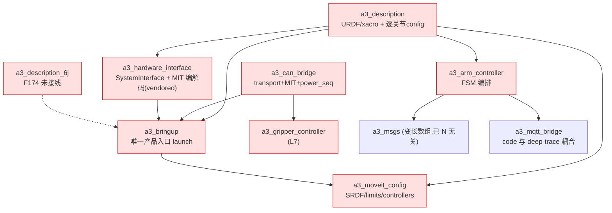
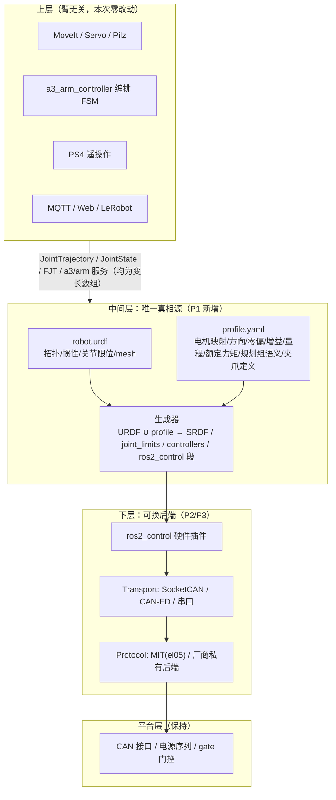

# 机械臂抽象化改造方案（换 URDF 即跑仿真 → 换配置即上真机）

> 目标：把本仓从「A3 专用栈」改造为「任意机械臂可跑」的通用栈。
> 一句话验收：**换一份 URDF + 一份 profile 配置 → mock 仿真直接跑通；再换 profile 的电机映射 → 真机直接跑通**，上层（MoveIt / 编排 / 遥操作 / MQTT / Web / LeRobot）零改动。

---

## 1. 结论摘要

| 问题 | 结论 |
|---|---|
| 本仓能否做到这种改造？ | **能，但不是小改**。当前无任何统一抽象层：关节名 `L1_joint..L7_joint`、关节数 7、连杆名、mesh、CAN ID、增益数组在 **7 个层次**全部硬编码。最大结构性障碍是贯穿多处的「上限常量 7」与「7 值数组」。 |
| 是否有可复用锚点？ | **有，且不少**。F52 运行期关节表（`motor_map.yaml`）、`include_gripper` 轴数开关、多臂 namespace launch、F38 的 `arm_controller_6j.yaml`（URDF 无关档）、`a3_bringup.launch.py` 的降级档选档与限位派生逻辑，都是现成的改造切入点。 |
| 契约层要不要大改？ | **基本不用**。`a3_msgs` 的消息/服务已全部使用变长数组（`float64[] positions/temperatures/ff_*` 等），只有 `SetPayload.srv` 的 `float64[3]`（质心）是定长，与关节数无关。 |
| reBot-DevArm 能否直接借鉴？ | **只能借鉴「驱动层 + 运动学层的配置化范式」，描述层不能**。它驱动侧极好（motorbridge 抽象 5 家电机、逐关节 vendor/model/ID/gain 全 YAML；Pinocchio 侧 URDF 路径与末端帧来自配置、关节名动态推导），但 MoveIt 侧的 URDF/SRDF/limits/controllers 是**逐型号手写副本**，夹爪关节名与 `gripper_tcp` 父 link 硬编码，6-DOF+夹爪假设贯穿。它自己也不是「换 URDF 即跑」。 |
| 本次落地范围（已确认） | **描述层优先**（换 URDF + profile → mock 仿真跑通）；**运行期任意 N 关节**（关节名配置驱动）；**自研 transport × protocol 抽象**（不引入 motorbridge）。 |

---

## 2. 现状分析

### 2.1 强耦合点清单（改造对象）

| # | 文件 | 硬编码内容 | 归属阶段 |
|---|---|---|---|
| C1 | [el_a3.urdf.xacro](../../src/a3_description/urdf/el_a3.urdf.xacro#L37-L205) | 连杆名 `l1_urdf_urdf_asm`..`l5_l6_urdf_asm`/`part_9`、mesh `package://a3_description/meshes/lN.stl`、惯量数值 | P1 |
| C2 | [el_a3.urdf.xacro](../../src/a3_description/urdf/el_a3.urdf.xacro#L212-L291) | 固定 6+1 个 `L*_joint`；关节限位数值写死在 `<limit>`（L1 ±2.79253、L2 0..3.66519、L3 −4.01426..0、L4 −1.0472..1.5708、L5/L6 ±1.5708、L7 0..1.78） | P1 |
| C3 | [el_a3_ros2_control.xacro](../../src/a3_description/urdf/el_a3_ros2_control.xacro#L154-L417) | 逐关节手写 `L1_joint..L7_joint` 块：`motor_id`(1..7)、`motor_type`(RS00/`wrist_motor_type`)、`direction`(±1)、`position_offset`、`kp`/`kd`、`zero_torque_kd_min/max` | P1 |
| C4 | [arm_mapper.hpp](../../src/a3_can_bridge/include/a3_can_bridge/arm_mapper.hpp#L34-L50) | 编译期 `kMaxArmJoints = 7`、`kChampJointNames`、`kTemporaryIndexMap` | P2 |
| C5 | [protocol_codec.hpp](../../src/a3_can_bridge/include/a3_can_bridge/protocol_codec.hpp) | 29 位扩展 CAN ID 位段、命令类型/参数索引/量程硬编码；按电机型号（EL05 ±6Nm/±50rad/s、RS00 ±14Nm/±33rad/s）分段量程 | P3 |
| C6 | [motor_protocol_node.cpp](../../src/a3_can_bridge/src/motor_protocol_node.cpp#L754) | `"...must have 7 elements"` 长度校验（`:754` tau_ff、`:768` gravity_joint_scale） | P2 |
| C7 | [control_gains.yaml](../../src/a3_can_bridge/config/control_gains.yaml) | 逐关节 7 值数组：`tau_ff_nominal_nm`、`joint_cmd_min/max_rad`、`joint_signs`、`joint_offsets_rad`、`gravity_joint_scale`、`motor_torque_range_nm`、`motor_speed_range_rad_s` | P2 |
| C8 | [motor_map.yaml](../../src/a3_can_bridge/config/motor_map.yaml#L10-L11) | `motor_ids_by_index`/`joint_names` 7 关节（运行期可配，但受 C4 上限约束） | P2 |
| C9 | [el_a3.srdf](../../src/a3_moveit_config/config/el_a3.srdf) | 规划组 `arm`(chain base_link→end_effector)/`arm_lin`/`gripper`(L7_joint)/`arm_with_gripper`、`group_state`、`disable_collisions` 连杆名 | P1 |
| C10 | [joint_limits.yaml](../../src/a3_moveit_config/config/joint_limits.yaml) | 逐关节速度/加速度/位置限位（注释直接绑定电机型号） | P1 |
| C11 | [moveit_controllers.yaml](../../src/a3_moveit_config/config/moveit_controllers.yaml) | `arm_controller` 列 `L1..L6`、`gripper_controller` 列 `L7_joint` | P1 |
| C12 | [kinematics.yaml](../../src/a3_moveit_config/config/kinematics.yaml) | 以规划组名为键（`arm`/`arm_lin`） | P1 |
| C13 | [arm_controller.py](../../src/a3_arm_controller/a3_arm_controller/arm_controller.py#L79-L87) | 模块级 `JOINTS` 常量；`joint_rated_torque` 默认 `[7,7,7,3,3,3,2]` | P2 |
| C14 | [arm_controller.yaml](../../src/a3_arm_controller/config/arm_controller.yaml#L6) | `joint_names` 与各话题名（话题名散落，无集中注册表） | P2 |
| C15 | [trajectory_bridge.py](../../src/a3_bringup/a3_bringup/trajectory_bridge.py#L26-L87) | `DEFAULT_JOINTS`；`joint1..joint7 → L{n}_joint` 重映射（唯一的跨命名适配逻辑，可推广） | P2 |
| C16 | [a3_bringup.launch.py](../../src/a3_bringup/launch/a3_bringup.launch.py#L147-L169) | xacro 文件写死；SRDF（`:317-319`）、controllers（`:165-169`）、`motor_map`（`:651-676`）按 `include_gripper` 二选一；6J 覆盖列表（`:486-490`） | P1 |
| C17 | [bridge.yaml](../../src/a3_mqtt_bridge/config/bridge.yaml) | telemetry `joints: [L1_joint..L7_joint]`（与 deep-trace 设备 YAML `points[].code` 强耦合） | 兼容保留 |
| C18 | [gripper_config.yaml](../../src/a3_gripper_controller/config/gripper_config.yaml) | `gripper_joint_name: L7_joint` / `index 6` / `motor_id 7` | P2 |
| C19 | [a3_robot.yaml](../../src/a3_lerobot_config/config/a3_robot.yaml) | `dof 7` / 关节名 / `motor_ids` / `joint_signs` / 限位 | P2 |
| C20 | [TOPIC_CONTRACT.md](../shared/TOPIC_CONTRACT.md) | 契约级 7 关节数组、关节名白名单 `L1_joint..L7_joint` | P0 |
| C21 | `config/{gravity_scales,inertia_params,friction_params,named_poses}.yaml` | 逐关节数组长度/键名 = 7 | P2 |

### 2.2 已参数化部分（改造锚点，直接扩展不重写）

| 机制 | 位置 | 现状 | 改造方向 |
|---|---|---|---|
| F52 运行期关节表 | [arm_mapper.hpp](../../src/a3_can_bridge/include/a3_can_bridge/arm_mapper.hpp#L77-L101) + [motor_map.yaml](../../src/a3_can_bridge/config/motor_map.yaml) | `joint_names`/`motor_ids_by_index` 运行期可配，**上限仍 7** | 去掉/放宽上限（P2） |
| `include_gripper` 轴数开关 | [el_a3.urdf.xacro](../../src/a3_description/urdf/el_a3.urdf.xacro#L281-L313) + [a3_bringup.launch.py](../../src/a3_bringup/launch/a3_bringup.launch.py#L102-L107) | 7J/6J 二档 | 收敛为 profile 字段（P1） |
| 降级档复制件 | `arm_controller_{5j,6j}.yaml`、`control_gains_{5j,generic}.yaml`、`motor_map_{5j,6j}.yaml`、[a3_description_6j](../../src/a3_description_6j/README.md) | 整份复制，改一处需同步多处（F174 已标注配套件未 6 轴化） | 由 profile 变量派生，消除漂移（P4） |
| 多臂 namespace | [multi_arm_config.yaml](../../src/a3_description/config/multi_arm_config.yaml) + `multi_arm_control.launch.py` | 每臂前缀/CAN 口/`wrist_motor_type` | 保留，profile 增加 `namespace` 维度 |
| 编排层关节表参数 | [arm_controller.py](../../src/a3_arm_controller/a3_arm_controller/arm_controller.py#L1068) | `joint_names` 可参数覆盖 | 默认值改为从 profile/URDF 派生（P2） |
| retime 限位派生 | [a3_bringup.launch.py](../../src/a3_bringup/launch/a3_bringup.launch.py#L383-L405) | 速度/加速度限位从 `joint_limits.yaml` 动态派生 | 直接复用（P1 生成物即其输入） |
| F38 通用 N 关节档 | [F38 需求](../edge/requirements/F38-generic-n-joint-init-teach-playback.md) | 已验证「URDF 无关 + 任意 N 关节 MIT 臂」的 init/示教/回放（真机 6 关节验收通过） | 作为 P1/P2 的功能基线 |

### 2.3 包依赖（现状）

> 注：`a3_hardware_interface/motor_model.hpp` 自述 "Vendored from a3_can_bridge … Keep in sync"，与 `a3_can_bridge` 存在编解码**代码重复**，P3 一并消重。

---

## 3. reBot-DevArm 对标调研结论

**证据来源**：`Seeed-Projects/reBot-DevArm`（Hub，无源码）、`Seeed-Projects/reBotArmController_ROS2`、`vectorBH6/reBotArm_control_py`、[motorbridge](https://motorbridge.seeedstudio.com)。

| 维度 | reBot 做法 | 是否「换 URDF 即跑」 | 可借鉴点 |
|---|---|---|---|
| 描述层 | 发两份**静态 URDF**（DM/RS），xacro 只用来 `include` URDF + ros2_control 宏 | **否**。xacro 里 `gripper_tcp` 父 link 硬编码（`end_link`/`gripper_end`） | 分层思路：URDF 只放拓扑/惯性/限位，其余全部外置到 YAML |
| 配置层 | `rebotarm_hardware.yaml` 的 `models:` 字典，每模型自带 `urdf_path`/`end_effector_frame`/`groups.arm.joints`/增益；启动时按 `model:=dm\|rs` 选档并与 SDK yaml **deep-merge** | **部分**（同构 6-DOF 臂可加 model 条目跑通） | **profile 字典 + deep-merge 选档**——本方案 P1 直接采用这一范式 |
| 驱动层 | 外部 motorbridge SDK：`add_<vendor>_motor()`，支持 DM/RobStride/MyActuator/HighTorque/Hexfellow，MIT/POS_VEL/VEL 模式；逐关节 `name/motor_id/feedback_id/model/vendor/kp/kd` 全 YAML | **是（同厂商内换型号/ID/PID 只改 YAML）** | transport × protocol 的抽象边界（本方案 P3 自研同类接口） |
| 跨厂商换电机 | `_write_pv_params` 内按 `vendor` 分支写不同寄存器；DM 走串口桥、RS 走 SocketCAN | **否**（仍需代码分支 + SDK 支持） | 认清边界：抽象到「可配置」而非「魔法通用」 |
| 控制/规划层 | `rebotarmcontroller` 是**薄适配层**，IK/URDF 逻辑不重复实现；`joint_names` 取自 `groups.arm.joints`（配置驱动） | 主体是 | 薄适配层 + 配置驱动关节名 |
| 运动学/动力学 | Pinocchio 侧 URDF 路径与末端帧来自配置；`get_joint_names` 遍历 `model.names` 动态获取；`controlled_joints` 支持少于 nq | **是** | URDF 派生关节表的参考实现 |
| MoveIt 层 | SRDF/kinematics/limits/controllers **逐型号手写副本**；夹爪关节名两套硬编码；6-DOF+夹爪假设贯穿 | **否** | 反面教材：本方案 P1 用生成替代复制 |

**结论**：reBot 是「**驱动层配置化 + 规划层定制**」。它不兼容任意 URDF/任意电机驱动的臂；跨厂商换电机仍需代码分支。本方案要在它之上补的正是**描述层自动派生 + 任意 N 关节 + 统一协议接口**这三块。

---

## 4. 目标架构

URDF 作为中间层：**上层只认 ROS 契约，下层只认 profile，URDF ∪ profile 是唯一真相源**。

**分层职责**（profile 必含字段，由 C1–C21 的硬编码逐条抽取而来）：

| 组 | 字段 | 来源硬编码 |
|---|---|---|
| 机械结构与关节 | `joint_names[]`、`n_joints`、`base_link`、`tip_link`、`joint_limits{}` | C2（来自 URDF，profile 只做覆盖） |
| 规划语义 | `groups{}`（chain/关节表）、`group_states{}`、`disable_collisions` 策略 | C9、C11、C12 |
| 电机映射 | `motor_ids[]`、`motor_type[]`、`direction[]`、`position_offset[]`、`bus` | C3、C8 |
| 增益与安全 | `kp[]`、`kd[]`、`zero_torque_kd_min/max[]`、`joint_rated_torque[]`、`static_torque_margin` | C3、C7、C13 |
| 量程 | `motor_torque_range_nm[]`、`motor_speed_range_rad_s[]` | C5、C7 |
| 动力学参数 | `gravity_scales[]`、`inertia_params`、`friction_Fc[]` | C21 |
| 末端 | `gripper{enabled, joint_name, motor_id, limits}` | C2、C18 |
| 集成 | `mqtt_signal_codes[]`、`lerobot_dof/ids` | C17、C19 |

**关键约束**：规划组名保持 `arm` / `arm_lin` / `gripper` 约定（否则 `servo_config.yaml`、pilz 配置、FSM 里的组名全要改）。

---

## 5. 已确认的设计决策

| 决策 | 选择 | 影响 |
|---|---|---|
| D1 抽象范围 | **描述层优先**：换 URDF + profile → mock 仿真跑通；真机驱动抽象留到 P3 | P1 是本次核心交付；P3 为第二阶段 |
| D2 关节模型 | **运行期任意 N 关节，关节名配置驱动** | 去掉 `kMaxArmJoints=7` 语义（改为 sanity 上限）；`"must have 7 elements"` 改 `NumJoints()`；契约层已就绪（变长数组），仅需同步 `TOPIC_CONTRACT.md` |
| D3 电机抽象 | **自研 `Transport × Protocol` 接口**（不引入 motorbridge） | P3 在 `a3_hardware_interface` 内抽接口，先用现有 MIT 后端填充；同时消重 `motor_model.hpp` 与 `a3_can_bridge` 编解码 |

---

## 6. 分阶段实施计划

### P0 — 需求先行与契约文档（不改代码）

1. 新增需求正文 `docs/edge/requirements/F175-robot-abstraction-layer.md`（下一个可用 ID，现最高为 F174），并在 [REQUIREMENTS.md](../edge/REQUIREMENTS.md) 索引表登记。验收标准见 §7 的 V1–V4。
2. 修改 [F146](../edge/requirements/F146-multi-vendor-motor-abstraction.md)：状态由 `proposed（冻结）` 改为「由 F175 P3 的 Protocol 抽象承接」，保留原验收标准。
3. 更新 [docs/shared/TOPIC_CONTRACT.md](../shared/TOPIC_CONTRACT.md)：把「关节名契约 `L1_joint..L7_joint`」「7 关节数组」改写为「profile 驱动的运行期关节表 + 变长数组」，标注 A3 profile 仍为 `L1..L7`。
4. 更新 [docs/shared/ROBOT_MODEL.md](../shared/ROBOT_MODEL.md)：新增「profile 字段表」章节；[docs/edge/ARCHITECTURE.md](../edge/ARCHITECTURE.md) 增加「描述层：URDF ∪ profile」分层说明（架构同步规则）。
5. 同步 [docs/README.md](../README.md) 索引（若新增文档）。

### P1 — 描述层参数化（核心，本次重点）

**新增包 `src/a3_robot_profile/`**（含 `README.md`，按 docs-update 规则）：

| 文件 | 内容 |
|---|---|
| `config/profiles/el_a3.yaml` | A3 profile：从 C1–C21 逐条抽取的当前值（**必须与现状逐值一致**，保证 P1 后行为不变） |
| `a3_robot_profile/loader.py` | 解析 profile + URDF：用 `urdf_parser_py`/`xacro` 读关节表、限位、`tip_link`；输出统一的 in-memory 模型 |
| `scripts/generate_robot_config.py` | `URDF ∪ profile → 生成物`：(a) ros2_control 段（替代 C3 的逐关节手写）；(b) SRDF（规划组/`group_state`/`disable_collisions` 由 URDF 链邻近关系自动生成）；(c) `joint_limits.yaml`；(d) `moveit_controllers.yaml`；(e) `controllers.yaml`；(f) `named_poses` 校验 |
| `launch/` | 可选：独立的 profile 校验 launch（不进主入口） |

**改造 [a3_bringup.launch.py](../../src/a3_bringup/launch/a3_bringup.launch.py)**：

- 新增参数 `robot_profile`（默认 `el_a3`）。
- `xacro_file`（`:147`）改为从 profile 读 `urdf_path`。
- `include_gripper`（`:102-107`）保留为兼容参数，内部映射为 profile 的 `gripper.enabled`。
- SRDF（`:317-319`）、controllers（`:165-169`）、`motor_map`（`:651-676`）的选择从「硬编码二选一」改为「按 profile 生成/加载」，删除 `:486-490` 的 6J 覆盖列表。
- 保持 mock/can 拓扑不变（`hardware:=mock|can` 语义不动）。

**本阶段不做**：不动 `a3_can_bridge` C++（P2）、不动协议编解码（P3）。

### P2 — 执行层任意 N 关节

| 文件 | 改动 |
|---|---|
| [arm_mapper.hpp](../../src/a3_can_bridge/include/a3_can_bridge/arm_mapper.hpp#L34-L50) | `kMaxArmJoints` 语义改为 sanity 上限（如 32）；`Configure()` 去掉 `> kMaxArmJoints` 的 7 相关约束；默认档位仍保留 A3 值 |
| [motor_protocol_node.cpp](../../src/a3_can_bridge/src/motor_protocol_node.cpp#L754) | `"...must have 7 elements"` → 与 `ArmMapper::NumJoints()` 比对（`tau_ff_nominal_nm`、`gravity_joint_scale` 两处） |
| [power_sequence_node.cpp](../../src/a3_can_bridge/src/power_sequence_node.cpp) | 同上，长度与广播展开按 `NumJoints()` |
| `control_gains.yaml` | 改为由 P1 生成物（profile → 逐关节数组），保留文件为 A3 profile 的输出 |
| [arm_controller.py](../../src/a3_arm_controller/a3_arm_controller/arm_controller.py#L79-L87) | `JOINTS` 默认值 → 从参数/URDF 派生；`joint_rated_torque` 默认 → profile |
| [gripper_config.yaml](../../src/a3_gripper_controller/config/gripper_config.yaml) | `gripper_joint_name`/`index`/`motor_id` 由 profile 派生；夹爪缺失（如 6 关节臂）时节点不启 |
| [a3_robot.yaml](../../src/a3_lerobot_config/config/a3_robot.yaml) | `dof`/关节名/`motor_ids` 由 profile 派生 |
| [bridge.yaml](../../src/a3_mqtt_bridge/config/bridge.yaml) | **兼容保留**：A3 profile 输出与现状完全一致的 `L1..L7` code；换臂需跨仓同步（见 §8 边界） |
| [trajectory_bridge.py](../../src/a3_bringup/a3_bringup/trajectory_bridge.py#L26-L87) | 把 `joint1..7 → L{n}_joint` 的映射推广为 profile 的 `joint_alias` 字段 |

### P3 — 电机/驱动抽象（自研，承接 F146）

1. 在 `a3_hardware_interface` 新增接口头：`transport.hpp`（`SocketCanTransport` / `CanFdTransport` / `SerialTransport`）、`protocol.hpp`（`writeCommand`/`readFeedback`/`encodeScale`）。
2. `A3MITHardwareInterface` 改为「按 profile 的 `motor.type` + `bus.type` 组装后端」，先只提供 `el05_mit` 后端（行为与现状一致）。
3. **消重**：把 `a3_hardware_interface/motor_model.hpp` 与 `a3_can_bridge` 的编解码合并为单一库（Custom message 场景注意 `ament_target_dependencies` 显式链接，参见 LL-148）。
4. 验收按 [F146](../edge/requirements/F146-multi-vendor-motor-abstraction.md)：新增一个协议后端仅需「新后端实现 + profile 条目」，上层零改动。

### P4 — 降级档收敛（消除复制漂移）

把 `5j/6j/generic` 的整份复制（含 [a3_description_6j](../../src/a3_description_6j/)）改为 profile 变量 + 生成物，删除冗余副本；`include_gripper` 作为 profile 字段正式替代参数级二选一。

---

## 7. 验证步骤

| 编号 | 验证 | 通过判据 |
|---|---|---|
| V1 | A3 回归：`ros2 launch a3_bringup a3_bringup.launch.py hardware:=mock robot_profile:=el_a3` | 与改造前行为**逐值一致**：关节表、限位、kp/kd、SRDF 组、`named_poses`、`/a3/*` 话题与服务不变；F22/F38 回归套件通过 |
| V2 | 外来臂仿真：新增 profile（6 关节、关节名 `joint1..joint6`、无夹爪、限位取自其 URDF） | mock 栈起 + RViz 正确显示 + MoveIt 规划到点位 + FJT 执行 + 编排层 init/示教/回放可用（对标 [F38](../edge/requirements/F38-generic-n-joint-init-teach-playback.md) 验收：init 计数确认、示教 ≥200 样本、回放首点无跳变） |
| V3 | 换 URDF 即跟随：只改 URDF 的关节限位与拓扑 | SRDF 规划组、`joint_limits.yaml`、`moveit_controllers.yaml` 自动跟随，**无需手改**任何 yaml |
| V4 | 真机切换：同 profile 改 `motor_ids/direction/position_offset` + `hardware:=can` | 帧正确、无甩臂（复用 F66 使能重锚与 0.8 s kp/kd 软起步）；安全门禁（F51 使能新鲜度、静态力矩 gate、温度保护）按 `NumJoints()` 正常工作 |
| V5 | P3 协议后端扩展：加一个非 MIT 后端 | 仅「新后端 + profile 条目」，上层与 launch 零改动；延迟实测 < 10 ms |

**安全回归重点**（LL 里反复踩坑处）：任意 N 关节下必须复测——F51 使能新鲜度门禁范围、静态力矩 gate 采样、温度保护 busy lock 与 COOLING→DISABLED 迁移、L7 夹爪重定时单独路径（`NumJoints()` 越界防护）。

---

## 8. 假设、边界与风险

**假设**

1. profile 生成在 **launch 期**（Python）完成，不引入构建期 codegen 步骤。
2. 规划组名保持 `arm` / `arm_lin` / `gripper` 约定（避免连锁改动 `servo_config.yaml` / pilz / FSM）。
3. `include_gripper` 参数保留（映射为 `gripper.enabled`），现有脚本与文档不破。
4. A3 profile 的 `joint_names` 仍为 `L1_joint..L7_joint`，MQTT/deep-trace 的 `code` 契约**本次不变**。

**边界（本次不做）**

- 不改 deep-trace（Web 仓）与 xiaozhi-esp32（固件仓）；换臂时的 MQTT code 同步按 `mqtt-contract-coupling.md` 跨仓进行。
- 不引入 motorbridge（D3）；不做多厂商协议实现，只做接口（P3）。
- 不改 CloudEdge 线（`a3_cloud_edge`）。

**风险**

| 风险 | 影响 | 缓解 |
|---|---|---|
| profile 值与现状不一致 | P1 后 A3 行为漂移（限位/增益差异 → 安全） | V1 逐值 diff；profile 从代码现状**机械抽取**而非重写 |
| `disable_collisions` 自动生成质量 | MoveIt 规划时报碰撞或漏检 | 先按 URDF 链邻近关系生成，A3 profile 允许 `manual_override` 段与现状对齐 |
| 任意 N 关节触碰安全门禁 | 越界/漏检 | P2 后用 V4 全量安全回归；`NumJoints()` 越界防护 + 静态力矩/温度路径复测 |
| 生成物分散导致追踪困难 | 排障时不知生效值来自哪 | 生成器输出统一落在 `<profile>_generated/` 并在启动日志打印完整有效配置 |
| xacro 不具备通用 `for` 循环 | 无法用 xacro 表达任意 N 关节 ros2_control 段 | 用 Python 生成器（而非 xacro 循环）承担该职责，xacro 只保留 A3 实例 + 宏 |

---

## 9. 交付物清单

1. 本方案文档（本文件）。
2. P0：`docs/edge/requirements/F175-robot-abstraction-layer.md` + 索引登记 + F146 状态修订 + `TOPIC_CONTRACT.md` / `ROBOT_MODEL.md` / `ARCHITECTURE.md` 更新。
3. P1：`src/a3_robot_profile/`（profile + loader + 生成器 + README）+ `a3_bringup.launch.py` profile 化。
4. P2：执行层与编排层任意 N 关节改造。
5. P3（第二阶段）：`transport × protocol` 接口 + MIT 后端 + 编解码消重。
