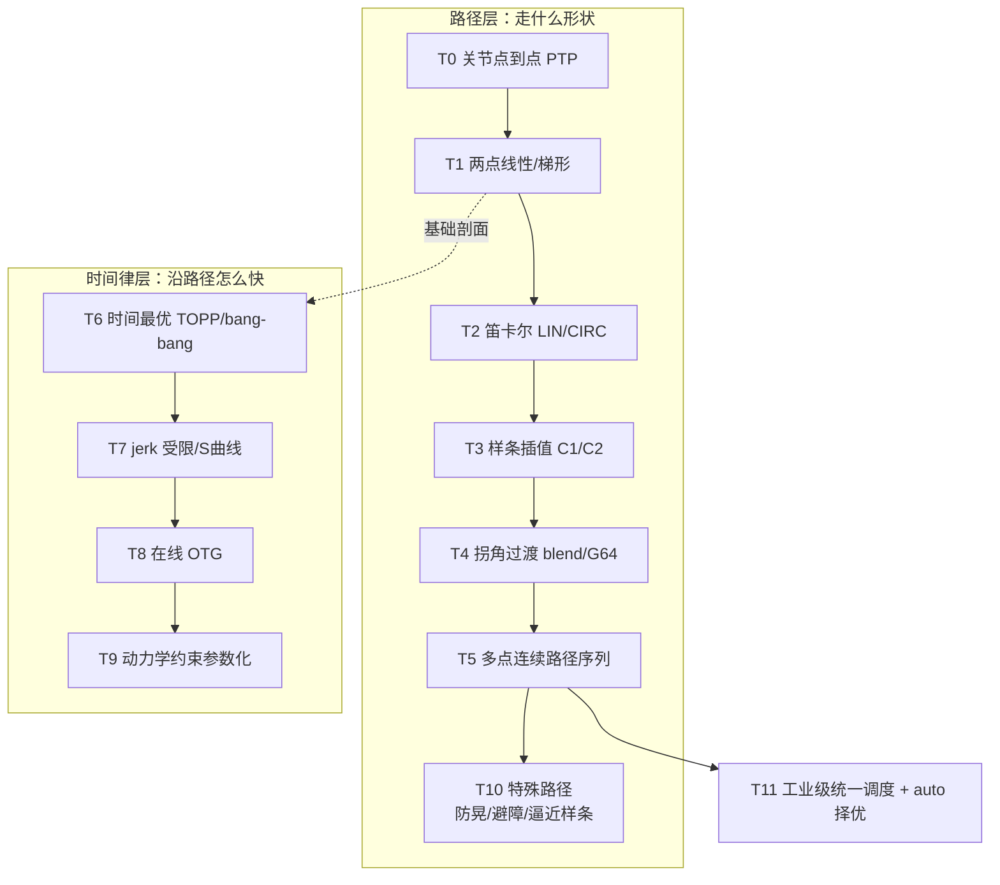

# 03. 轨迹规划与时间律 — 进阶清单

> **定位：** 把「从哪到哪」变成「该怎么动、多快动、动不动得起」——本项目最厚的一块，含路径层与时间律层两条子阶梯。
> **覆盖 [CONTROL_ROADMAP](../shared/CONTROL_ROADMAP.md) 层级：** L2（轨迹执行与时间插值）、L4（运动规划）、L5（规划执行闭环）、L6（实时笛卡尔）中的轨迹部分。
> **涉及本仓需求：** F1/F6/F11/F15/F41/F59/F67/F68/F76/F88/F94/F126/F134/F137/F161/F163/F164/F165/F166/F167。
> **配套文档：** [edge/TRAJECTORY_MODE_SELECTION.md](../edge/TRAJECTORY_MODE_SELECTION.md)（9 模式选型）、[shared/TRAJECTORY_KINDS.md](../shared/TRAJECTORY_KINDS.md)（playback kind）。
> **图例：** ✅ 已实现 · ⚠️ 部分实现 · ❌ 未实现 · 🔜 已立项规划 · ※ 社区非官方

## 1. 阶梯总览

| 级别 | 名称 | 一句话 | 相对上一级新增的能力 | 本仓状态 |
|---|---|---|---|---|
| T0 | 关节点到点（PTP） | 逐段、每点停车 | 最基本可控运动 | ✅ F67 |
| T1 | 两点线性 / 梯形剖面 | 起止零速、匀速段 | 从「快慢不可控」到「受速度上限约束」 | ✅ F88/F94 |
| T2 | 笛卡尔直线 LIN / 圆弧 CIRC | 工作空间走直线/圆弧 | 从关节空间到**工作空间路径约束** | ✅ pilz F76/F164 |
| T3 | 样条插值（三次/五次） | 位置+速度+加速度连续 | 从「拐点顿挫」到 C1/C2 连续 | ✅ F15/F137 |
| T4 | 拐角过渡 blend | 中间点不停车、消加速度尖峰 | 从「每点停车」到「连续过点」 | ✅ F165 G64 / pilz blend |
| T5 | 多点连续路径序列 | MoveJ/L/C 混编一条序列 | 从「单段」到「多段连续执行」 | ✅ pilz Sequence F134 / F163 |
| T6 | 时间最优（bang-bang/TOPP） | 给定路径下最短时间 | 从「够快」到「理论最快」 | ⚠️ F167.2 离线 |
| T7 | jerk 受限 / S 曲线 | 限制加加速度、降抖动 | 从「快」到「快而不抖」 | ✅ F68/F161/F167.1 |
| T8 | 在线 OTG（实时轨迹生成） | 目标可变不停车、急停 | 从「离线规划」到「在线改目标」 | ⚠️ 演示 F167.3 |
| T9 | 动力学约束参数化 | 时间参数化同时满足力矩 | 从「运动学最优」到「力矩可行」 | ⚠️ F167.2 离线 |
| T10 | 特殊路径 | 防晃运输/避障/逼近样条 | 面向具体工艺的路径处理 | ❌ 防晃；✅ 避障/逼近样条 |
| T11 | 工业级统一调度 + auto 择优 | 9 模式注册表 + 自动选型 | 从「一堆模式」到「一个入口统一调度」 | ✅ F165/F166 |

## 2. 逐级详解

### T0 — 关节点到点（PTP）

- **是什么：** 给定目标关节角，一条腿走到位；多点时逐段执行，**每个点停车**。
- **新增功能点（相对没有任何轨迹）：** 有了「可重复地从一个构型到另一个构型」的能力，是最稳的起点。
- **关键方法 / 组件：** 关节空间规划（OMPL）+ 时间参数化（TOTG）；单腿或作多段逐腿。
- **工业对标：** KUKA PTP / ABB MoveAbsJ。
- **本仓状态：** ✅ [F67](../edge/requirements/F67-goto-move-to-moveit-totg.md)（goto/move_to 走 move_group + TOTG，起止零速）。
- **验收 / 自测点：** 到位准确、起止零速、无过冲。

### T1 — 两点线性 / 梯形速度剖面

- **是什么：** 关节空间线性插值，速度用梯形剖面（加速→匀速→减速）；对时长有兜底与插值密度要求。
- **新增功能点（相对 T0）：** 从「能到」到「按受控速度曲线到」——起止零速、受速度上限约束，不再无限速。
- **关键方法 / 组件：** 梯形速度剖面、时长兜底、插值密度（≥50 Hz）、速度限幅（兜住绕过规划器的 jog/park）。
- **工业对标：** 梯形速度规划、S 曲线的前身。
- **本仓状态：** ✅ 标准两点轨迹替代手搓密集插值 [F88](../edge/requirements/F88-two-point-standard-trajectory.md)；速度统一限幅 [F94](../edge/requirements/F94-two-point-velocity-limit.md)；插值密度 [F41](../edge/requirements/F41-move-to-duration-interp-density.md)。
- **验收 / 自测点：** 时长按 `time_from_start` 一致；超速被钳位。

### T2 — 笛卡尔直线 LIN / 圆弧 CIRC

- **是什么：** 末端沿工作空间中的直线（LIN）或圆弧（CIRC）运动，关节角由 IK 实时给出。
- **新增功能点（相对 T1）：** 从「关节空间」到「工作空间路径约束」——末端走的是直线/圆弧，这是抓取、涂胶、焊接等工艺的硬要求。
- **关键方法 / 组件：** pilz LIN/CIRC（`lin_exact`/`lin_blend`/`circ`）、三点定圆弧、路径约束（interim 辅助点）。
- **工业对标：** KUKA LIN/CIRC、ABB MoveL/MoveC。
- **本仓状态：** ✅ pilz 工业规划器 [F76](../edge/requirements/F76-pilz-industrial-planner.md)；连续笛卡尔路径 kind `cp` + CIRC [F164](../edge/requirements/F164-cp-cartesian-path-kind.md)。
- **验收 / 自测点：** 末端轨迹在工作空间为直线/圆弧；姿态随路径平滑。

### T3 — 样条插值（三次 / 五次），C1/C2 连续

- **是什么：** 用样条连接多点，使位置、速度（C1）甚至加速度（C2）连续；JTC 语义兼容的 auto 样条（仅 pos→线性；+v→三次；+a→五次）。
- **新增功能点（相对 T2）：** 从「分段拼接」到「整条光滑」——多点的位置/速度/加速度连续，消除段间突变。
- **关键方法 / 组件：** 三次/五次样条、B 样条、JTC splines 控制器侧插值。
- **工业对标：** KUKA SPLINE、ABB 的样条运动。
- **本仓状态：** ✅ JTC 兼容样条插值 [F15](../edge/requirements/F15-jtc-spline-interpolation.md)；五次 B 样条几何去噪 [F137](../edge/requirements/F137-recorded-trajectory-denoise.md)。
- **验收 / 自测点：** 多点轨迹一二阶连续；无速度/加速度跳变。

### T4 — 拐角过渡 blend

- **是什么：** 在中间路点处不停车，用一段过渡（pilz blend / 关节折线 G64 二次 Bezier 圆角）平滑切角。
- **新增功能点（相对 T3）：** 从「必须经过点就停车」到「连续过点」——消除中间点处的加速度尖峰，整条轨迹不再被单个拐角拖慢。
- **关键方法 / 组件：** 圆角半径（`goto_via_corner_blend_rad`，二次 Bezier，C1 连续）、pilz blend 半径、逐点 `exact` 控制是否精确过点。
- **工业对标：** 商用控制器 G64 连续路径 / G61 精确停；KUKA PTP+blend。
- **本仓状态：** ✅ G64 拐角圆滑 [F165](../edge/requirements/F165-trajectory-mode-industrial-optimization.md)；pilz blend [F134](../edge/requirements/F134-multi-point-pilz-sequence.md)。修复了减速段速度不连续 bug（LL-154）。
- **验收 / 自测点：** 中间点不停车；拐角无加速度尖峰；直线段保形不过冲。

### T5 — 多点连续路径序列

- **是什么：** 把 PTP/LIN/CIRC/blend 等段**混编为一条序列**一次规划、连续执行（pilz Sequence），或单条过点样条跨点过渡（via）。
- **新增功能点（相对 T4）：** 从「一种过渡方式」到「异质多段统一编排」——一条任务里既有笛卡尔直线又有圆弧又有不停车过渡。
- **关键方法 / 组件：** pilz Sequence + blend、via 过点样条（单条 C2 轨迹）、Sequence 整体规划失败时逐段回退。
- **工业对标：** KUKA 程序段序列 / ABB 多运动指令连续执行。
- **本仓状态：** ✅ 多点 pilz Sequence [F134](../edge/requirements/F134-multi-point-pilz-sequence.md)；via 过点平滑过渡 [F163](../edge/requirements/F163-via-point-smooth-transition.md)；巡游轨迹平滑 + retime [F161](../edge/requirements/F161-tour-trajectory-smooth-retime.md)。
- **验收 / 自测点：** 一条序列连续执行完毕，中间不停车；整体规划失败时有确定回退。

### T6 — 时间最优（bang-bang / TOPP）

- **是什么：** 在给定几何路径上求**最短时间**的速度剖面（TOPP/TOPP-RA/TOPP-IO），在速度/加速度约束下尽量猛加速。
- **新增功能点（相对 T5）：** 从「凭经验设速度」到「路径给定下的数学最优耗时」。
- **关键方法 / 组件：** 时间最优路径参数化（TOPP）、bang-bang 控制、凸优化（TOPP-RA）。
- **工业对标：** 商用控制器的「时间最优」；Reflexxes、TOPP-RA。
- **本仓状态：** ⚠️ 离线可用 [F167](../edge/requirements/F167-trajectory-lib-upgrade-ruckig-toppra-otg.md).2（`scripts/traj_retime_toppra.py`，未接生产）。
- **验收 / 自测点：** 相对基线耗时缩短且约束不越界。

### T7 — jerk 受限 / S 曲线 / 震颤最小化

- **是什么：** 在时间参数化时限制加加速度（jerk），或直接用低抖动剖面（quintic / 钟形），换取更小的机械冲击。
- **新增功能点（相对 T6）：** 从「最快」到「快而不抖」——jerk 受限显著降低机械振动、冲击与磨损。
- **关键方法 / 组件：** Ruckig、TOTG、quintic、钟形剖面；时间律可切换 `software`/`totg`/`ruckig`（`goto_via_time_backend`）。
- **工业对标：** S 曲线 / jerk-limited 运动、Ruckig（在线 jerk 受限）。
- **本仓状态：** ✅ 示教回放 Ruckig/TOTG 重定时 [F68](../edge/requirements/F68-teach-playback-ruckig-retime.md)；巡游 retime [F161](../edge/requirements/F161-tour-trajectory-smooth-retime.md)；时间律库升级 [F167](../edge/requirements/F167-trajectory-lib-upgrade-ruckig-toppra-otg.md).1（实测 totg 快 30–60% 但 j_rms 高 2–8×）。
- **验收 / 自测点：** j_rms 降低；机械无明显抖动/异响。

### T8 — 在线 OTG（实时轨迹生成）

- **是什么：** 运行时按当前状态在线生成轨迹：目标可随时更改而不停车、多轴同步到齐、支持在线急停。
- **新增功能点（相对 T7）：** 从「一次性离线规划」到「实时可打断/可改目标」——遥操作、动态避障、抓取目标的在线调整都需要它。
- **关键方法 / 组件：** OTG（如 Ruckig 在线模式、Reflexxes 类）、多轴同步（synchronized phase）、改目标不停车、急停。
- **工业对标：** Reflexxes/`ReflexxesTypeII`、工业控制器的在线重规划。
- **本仓状态：** ⚠️ 仿真演示 [F167](../edge/requirements/F167-trajectory-lib-upgrade-ruckig-toppra-otg.md).3（`a3_trajectory_processing/otg_demo`，同步 0ms、改目标不停车、急停 200ms；**未接**生产 SERVO/teleop）。
- **验收 / 自测点：** 在线改目标不停车；急停平稳；多轴同步到齐。

### T9 — 动力学约束时间参数化

- **是什么：** 时间参数化时同时满足**力矩约束**（含摩擦/惯量/科氏），必要时叠加自定义凸约束，使轨迹在动力学上真正可行。
- **新增功能点（相对 T8）：** 从「运动学可行」到「动力学可行」——高动态轨迹不会因为电机力矩不够而跟踪不上。
- **关键方法 / 组件：** TOPP-RA + Pinocchio `rnea` 力矩约束、`|W·q̈| ≤ c` 自定义凸约束、baked 回放。
- **工业对标：** 动力学一致时间参数化、工业控制器力矩预测限幅。
- **本仓状态：** ⚠️ 离线 [F167](../edge/requirements/F167-trajectory-lib-upgrade-ruckig-toppra-otg.md).2（本仓已有静态力矩门禁，见 [F129](../edge/requirements/F129-square-playback-led-yaml-speed.md)）。
- **验收 / 自测点：** 轨迹全程力矩不越限；高动态段不丢跟踪。

### T10 — 特殊路径（防晃 / 避障 / 逼近样条）

- **是什么：** 面向具体问题的路径处理：运输防晃（slosh-free，输入整形 + 摆模型前馈）、带避障的规划路径、用最小二乘逼近样条抗过冲。
- **新增功能点（相对 T9）：** 从「通用轨迹」到「特定工艺」——例如端一杯水不洒、绕开障碍物、多散点不过冲拟合。
- **关键方法 / 组件：** ZV/ZVD 输入整形 + 球摆模型；OMPL 避障；scipy 最小二乘 B 样条（`jnt_spline_approx`）。
- **工业对标：** slosh-free 运输、避障规划、拟合样条（B-spline fitting）。
- **本仓状态：** ❌ **防晃运输为对标缺口**（仅 jerk-limited 可减弱不可消除，见 [TRAJECTORY_KINDS.md](../shared/TRAJECTORY_KINDS.md)）；✅ 避障（OMPL）与逼近样条 `jnt_spline_approx`（[F166](../edge/requirements/F166-trajectory-mode-registry-9mode-auto.md)）。
- **验收 / 自测点：** 防晃场景液体峰值摆角达标；避障路径无碰撞；散点拟合不过冲（<0.3 rad）。

### T11 — 工业级统一调度 + 离线 auto 择优

- **是什么：** 把上面所有模式收进**统一注册表**（9 种规范名 + 别名），并提供逐点 `exact` 与离线自动选型（`mode: auto` → 按时长/平滑加权择优）。
- **新增功能点（相对 T10）：** 从「一堆独立模式」到「一个入口统一调度 + 自动选型」——使用者不必手挑模式，工具按约束离线推荐。
- **关键方法 / 组件：** `arm_controller.TRAJ_MODES` 注册表、`resolve_traj_mode()`、`traj_plan_auto.py`、`traj_mode_recommend.py`。
- **工业对标：** KUKA/ABB 的多种运动类型 + 控制器内部选型。
- **本仓状态：** ✅ 9 模式注册表 + 逐点 exact + 离线 auto [F166](../edge/requirements/F166-trajectory-mode-registry-9mode-auto.md)；工业级优化与推荐器 [F165](../edge/requirements/F165-trajectory-mode-industrial-optimization.md)。
- **验收 / 自测点：** 规范名/别名均可解析；auto 输出确定且可解释（带报告）。

## 3. 本仓可继续进阶（缺口清单）

- ❌ **防晃运输（slosh-free）**：需输入整形（ZV/ZVD）+ 球摆模型前馈，本仓为对标缺口。
- ⚠️ **在线 OTG 接生产**：演示已有（[F167](../edge/requirements/F167-trajectory-lib-upgrade-ruckig-toppra-otg.md).3），需接入 SERVO/teleop 实时链路。
- ⚠️ **力矩约束时间参数化接生产**：toppra 离线可用，需并入在线/回放主链。
- 🔜 **避障与视觉路径融合**：OMPL 避障已用，结合感知（视觉抓取）的在线避障未做。
- ⚠️ **时间律统一化**：`software`/`totg`/`ruckig` 三后端切换已通，但缺少统一的质量门禁（j_rms/耗时阈值）。

## 4. 参考

- 本仓：[edge/TRAJECTORY_MODE_SELECTION.md](../edge/TRAJECTORY_MODE_SELECTION.md)（9 模式选型/速度梯度/G64）、[shared/TRAJECTORY_KINDS.md](../shared/TRAJECTORY_KINDS.md)（kind 清单）、[dev/F167_TRAJECTORY_LIB_UPGRADE_REPORT.md](../dev/F167_TRAJECTORY_LIB_UPGRADE_REPORT.md)（Ruckig/TOPP-RA/OTG A/B）
- 实现：[arm_controller.py](../../src/a3_arm_controller/a3_arm_controller/arm_controller.py)（`_round_corners`、`_jerk_limited_timed_traj`、`_goto_via_smooth`）、[arm_controller.yaml](../../src/a3_arm_controller/config/arm_controller.yaml)、[trajectory_interpolator.hpp](../../src/a3_can_bridge/include/a3_can_bridge/trajectory_interpolator.hpp)
- 需求：[F6](../edge/requirements/F6-trajectory-time-tracking.md)、[F15](../edge/requirements/F15-jtc-spline-interpolation.md)、[F134](../edge/requirements/F134-multi-point-pilz-sequence.md)、[F137](../edge/requirements/F137-recorded-trajectory-denoise.md)、[F161](../edge/requirements/F161-tour-trajectory-smooth-retime.md)、[F164](../edge/requirements/F164-cp-cartesian-path-kind.md)、[F165](../edge/requirements/F165-trajectory-mode-industrial-optimization.md)、[F166](../edge/requirements/F166-trajectory-mode-registry-9mode-auto.md)、[F167](../edge/requirements/F167-trajectory-lib-upgrade-ruckig-toppra-otg.md)
- 外部：KUKA PTP/LIN/CIRC/SPLINE、ABB MoveAbsJ/MoveL/MoveC、MoveIt TOTG/Pilz、Ruckig、TOPP-RA、Reflexxes OTG
