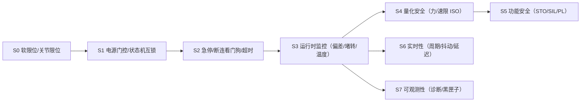

# 06. 安全与实时 — 进阶清单

> **定位：** 横切所有模块的「不出事」与「够快」——每一层跑起来之前，先回答「出事了怎么停、延迟够不够、异常能不能被发现」。
> **覆盖 [CONTROL_ROADMAP](../shared/CONTROL_ROADMAP.md) 层级：** 横切 L0–L8（不单独占层，约束所有层）。
> **涉及本仓需求：** F2/F21/F44/F45/F50/F51/F53/F60/F71/F81/F82/F86/F90/F95/F100/F101/F102/F103/F104/F107/F130。
> **配套文档：** [shared/SAFETY.md](../shared/SAFETY.md)、[edge/STATE_MACHINE.md](../edge/STATE_MACHINE.md)。
> **图例：** ✅ 已实现 · ⚠️ 部分实现 · ❌ 未实现 · 🔜 已立项规划 · ※ 社区非官方

## 1. 阶梯总览

| 级别 | 名称 | 一句话 | 相对上一级新增的能力 | 本仓状态 |
|---|---|---|---|---|
| S0 | 软限位 + 关节限位 | 越界保护 | 从「能到任意角度」到「到不了危险角」 | ✅ URDF + 执行层 |
| S1 | 电源门控 + 状态机互锁 | 谁能动、何时动 | 从「随时能动」到「有条件才能动」 | ✅ F2/F21/F45/F53 |
| S2 | 急停 / 断连看门狗 / 通信超时 | 异常确定性停机 | 从「正常流程」到「异常可停」 | ✅ F60/F81/F86/F101 |
| S3 | 运行时监控 | 偏差/堵转/温度检测与降级 | 从「断了才停」到「跑偏也停」 | ✅ F44/F50/F130 |
| S4 | 量化安全（力/速/动量限） | 协作安全的法律级限值 | 从「工程经验」到「标准限值」 | ⚠️ F107（部分） |
| S5 | 功能安全（STO/SIL/PL） | 硬件安全回路 | 从「软件保护」到「硬件保证」 | ❌ |
| S6 | 实时性（周期/抖动/延迟） | 控制环确定性 | 从「平均值够快」到「最坏情况也够快」 | ⚠️ F100（部分） |
| S7 | 可观测性（诊断/黑匣子） | 现场排障与追溯 | 从「黑盒」到「可诊断、可复盘」 | ✅ F71/F82/F90/F95/F102/F103/F104 |

## 2. 逐级详解

### S0 — 软限位 + 关节限位

- **是什么：** 在 URDF/规划器和执行层同时定义关节上下限，越界指令被钳位或拒绝。
- **新增功能点（相对无保护）：** 机械臂不会走到会自碰/损坏的角度。
- **关键方法 / 组件：** URDF 关节限位、执行层软限位、开机零位校验。
- **工业对标：** 软限位（soft limit）、硬限位开关（hard limit）区分。
- **本仓状态：** ✅ URDF + 执行层限位；开机零位校验 [F48](../edge/requirements/F48-boot-zero-position-check.md)；L7 限位三处统一 [F98](../edge/requirements/F98-l7-gripper-limit-calibration.md)。
- **验收 / 自测点：** 越界指令被拒/钳位；开机姿态越限会拒绝使能。

### S1 — 电源门控 + 状态机互锁

- **是什么：** 引入电源状态机与安全门（gate），并让编排层显式定义「指令 × 状态 × 模式」的接受/拒绝矩阵，收拢所有「谁能动」的判断。
- **新增功能点（相对 S0）：** 从「限位保护」到「流程保护」——gate 关闭、模式冲突、未使能等情况下确定性拒绝运动，杜绝误触发。
- **关键方法 / 组件：** 电源序列、`/power_sequence/gate_open`、编排状态机（11 态）、模式互锁（`/a3/control_mode`）、全组合显式拒绝。
- **工业对标：** 使能/运行状态机、操作模式互锁（operation mode interlock）。
- **本仓状态：** ✅ [F2](../edge/requirements/F2-power-sequence-gating.md)（电源门控）、[F21](../edge/requirements/F21-arm-orchestration-node.md)（编排节点）、[F45](../edge/requirements/F45-state-machine-11-states.md)（11 态）、[F53](../edge/requirements/F53-orchestration-full-explicit-rejection.md)（全组合显式拒绝）；见 [STATE_MACHINE.md](../edge/STATE_MACHINE.md)。
- **验收 / 自测点：** 非法指令在所有状态下被明确拒绝并给出原因；gate 关时不发任何运动令。

### S2 — 急停 / 断连看门狗 / 通信超时

- **是什么：** 提供硬急停（一键停机 + 关 gate）、单电机反馈断线看门狗、通信超时与整机看门狗，异常时确定性进入安全态。
- **新增功能点（相对 S1）：** 从「顺流程」到「异常也能停」——通讯断了、电机失联、进程挂了都能被发现并停机/保持。
- **关键方法 / 组件：** 硬急停（Cross 长按）、电机 last-rx 超时锁存、电机侧通信超时（`0x7028`）、硬件 watchdog + systemd 双层。
- **工业对标：** 急停回路（E-stop）、通信看门狗、心跳超时停机。
- **本仓状态：** ✅ [F60](../edge/requirements/F60-ps4-keymap-redesign.md)（单键硬急停）、[F81](../edge/requirements/F81-motor-feedback-loss-watchdog.md)（反馈断线）、[F86](../edge/requirements/F86-motor-comm-timeout-config.md)（电机侧超时）、[F101](../edge/requirements/F101-watchdog-hardening.md)（watchdog 硬化）。
- **验收 / 自测点：** 急停后 gate 关闭、电机失能；拔线被检测并冻结保持；进程挂死能自动重启。

### S3 — 运行时监控（偏差 / 堵转 / 温度 / 碰撞）

- **是什么：** 运行中持续比较「期望 vs 实际」，检测跟踪偏差过大、堵转、过热、异常，并按严重度升级处置。
- **新增功能点（相对 S2）：** 从「断了才停」到「跑偏也停」——在故障酿成事故前介入，并支持降级档（缺电机运行）。
- **关键方法 / 组件：** 故障监视看门狗（arm_monitor）、期望-实际偏差门限、温度管理（warn/protect/COOLING）、缺电机降级、Safe Park 残差容忍。
- **工业对标：** 跟踪误差监控（following error）、过载/过热保护、安全停机（safe park）。
- **本仓状态：** ✅ [F50](../edge/requirements/F50-fault-monitor-watchdog.md)（故障监控）、[F44](../edge/requirements/F44-temperature-management.md)（温度）、[F52](../edge/requirements/F52-missing-motor-degradation.md)（缺电机降级）、[F130](../edge/requirements/F130-r3-safe-park-residual-tolerance.md)（Safe Park 残差）；待办 [F140](../edge/requirements/F140-safe-park-shutdown.md)（Safe Park & Shutdown，🔜）。
- **验收 / 自测点：** 人为卡住关节触发偏差告警并处置；过热进入 COOLING 并自动恢复。

### S4 — 量化安全（速度 / 力矩 / 动量限制）

- **是什么：** 按安全标准（ISO 10218、ISO/TS 15066）对协作速度、接触力、动量设定**定量限值**，而非仅凭工程经验。
- **新增功能点（相对 S3）：** 从「工程保护」到「标准合规」——面向人机协作场景的法律级安全保证。
- **关键方法 / 组件：** 速度/力/功率限制、额定负载与占空比门禁、协作操作模式。
- **工业对标：** ISO 10218-1/2、ISO/TS 15066（功率与力限制协作机器人）。
- **本仓状态：** ⚠️ 部分——额定负载与占空比静态门禁 [F107](../edge/requirements/F107-rated-payload-duty-gate.md)；**协作安全力/速限值未系统实现**。
- **验收 / 自测点：** 速度/力矩按人体部位限值可配置并被执行；有安全评估记录。

### S5 — 功能安全（STO / SBC / 安全 PLC / 双通道）

- **是什么：** 用硬件安全回路（安全继电器/安全 PLC、双通道、STO 安全转矩关断、SBC 安全制动控制）实现**与软件无关**的安全保证，达到 SIL/PL 等级。
- **新增功能点（相对 S4）：** 从「软件保护」到「硬件保证」——即使软件完全失效，也能安全停机。
- **关键方法 / 组件：** STO/SBC、双通道冗余、诊断覆盖率、安全 PLC 逻辑。
- **工业对标：** IEC 61508（SIL）、ISO 13849（PL d/e）、安全转矩关断（STO）。
- **本仓状态：** ❌ 未实现（依赖硬件安全回路与驱动器 STO 支持）。
- **验收 / 自测点：** 触发 STO 后电机无力矩输出；安全回路通过功能安全评估。

### S6 — 实时性（周期 / 抖动 / 延迟预算）

- **是什么：** 让控制环以**确定周期**运行——实时调度（SCHED_FIFO）、固定周期、受限抖动、明确的端到端延迟预算。
- **新增功能点（相对「非实时」）：** 从「平均值够快」到「最坏情况也够快」——高动态控制与力控环的前提。
- **关键方法 / 组件：** `controller_manager` 实时调度、控制环周期与抖动测量、延迟预算（本仓目标板内 < 10 ms）。
- **工业对标：** 实时控制周期（1 ms 级）、抖动预算、实时 Linux（PREEMPT_RT）。
- **本仓状态：** ⚠️ 部分——实时调度硬化 [F100](../edge/requirements/F100-realtime-sched-hardening.md)；**抖动未量化**，非功能目标见 [edge/REQUIREMENTS.md](../edge/REQUIREMENTS.md)（板内 < 10 ms）。
- **验收 / 自测点：** 控制环确为 SCHED_FIFO；周期抖动在预算内（待量化）。

### S7 — 可观测性（诊断 / 黑匣子 / 健康聚合）

- **是什么：** 把各子系统健康统一进标准诊断通道，并在故障时自动落盘「黑匣子」，支持现场排障与事后复盘。
- **新增功能点（相对「黑盒」）：** 从「出问题靠猜」到「可诊断、可复盘」——链路/总线/话题/主机健康可观测，故障有据可查。
- **关键方法 / 组件：** `diagnostic_updater`/`diagnostic_aggregator`、`rosbag2` snapshot 黑匣子、自检服务、CAN/MQTT/话题频率健康、主机资源诊断。
- **工业对标：** 标准诊断（ROS diagnostics）、黑匣子（blackbox）、健康聚合与 top-level 状态。
- **本仓状态：** ✅ [F71](../edge/requirements/F71-arm-monitor-diagnostics.md)、[F82](../edge/requirements/F82-diagnostic-aggregator.md)、[F90](../edge/requirements/F90-fault-triggered-rosbag2-blackbox.md)（黑匣子）、[F95](../edge/requirements/F95-standard-self-test.md)（自检）、[F96](../edge/requirements/F96-host-resource-diagnostics.md)（主机）、[F102](../edge/requirements/F102-mqtt-link-health-diagnostics.md)/[F103](../edge/requirements/F103-can-bus-health-diagnostics.md)/[F104](../edge/requirements/F104-topic-rate-health-diagnostics.md)。
- **验收 / 自测点：** 断链路/掉频率在 `/diagnostics` 与聚合状态可见；FAULT/COOLING 边沿自动落盘 mcap。

## 3. 本仓可继续进阶（缺口清单）

- ⚠️ **协作安全量化限值（S4）**：按 ISO/TS 15066 落地速度/力/动量限。
- ❌ **功能安全（S5）**：STO/SBC 硬件安全回路与 SIL/PL 评估。
- ⚠️ **实时抖动量化（S6）**：把「周期抖动 / 端到端延迟」纳入门禁与诊断。
- 🔜 **Safe Park & Shutdown**（[F140](../edge/requirements/F140-safe-park-shutdown.md)）：慢速回安全位姿再失能的产品化。
- 🔜 **诊断值班视图**（[F143](../edge/requirements/F143-rqt-robot-monitor-view.md)）：rqt_robot_monitor 排障 SOP。
- ❌ **量化安全评估记录**：面向交付/认证的安全性文档与测试。

## 4. 参考

- 本仓：[shared/SAFETY.md](../shared/SAFETY.md)、[edge/STATE_MACHINE.md](../edge/STATE_MACHINE.md)、[CONTROL_ROADMAP.md](../shared/CONTROL_ROADMAP.md)、[edge/ARCHITECTURE.md](../edge/ARCHITECTURE.md)
- 需求：[F2](../edge/requirements/F2-power-sequence-gating.md)、[F44](../edge/requirements/F44-temperature-management.md)、[F50](../edge/requirements/F50-fault-monitor-watchdog.md)、[F53](../edge/requirements/F53-orchestration-full-explicit-rejection.md)、[F81](../edge/requirements/F81-motor-feedback-loss-watchdog.md)、[F90](../edge/requirements/F90-fault-triggered-rosbag2-blackbox.md)、[F100](../edge/requirements/F100-realtime-sched-hardening.md)、[F101](../edge/requirements/F101-watchdog-hardening.md)、[F107](../edge/requirements/F107-rated-payload-duty-gate.md)、[F140](../edge/requirements/F140-safe-park-shutdown.md)
- 外部：ISO 10218-1/2、ISO/TS 15066、IEC 61508（SIL）、ISO 13849（PL）、ROS 2 diagnostics、PREEMPT_RT
