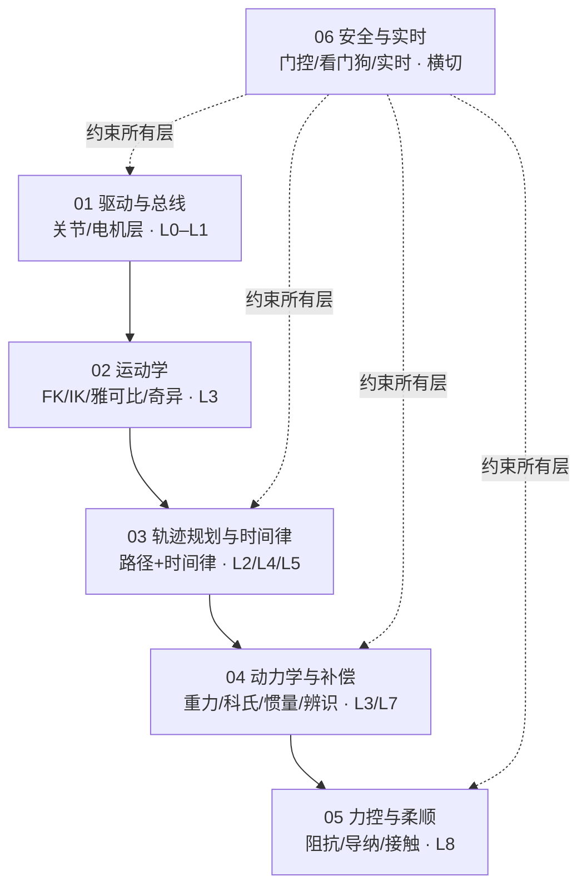

# 机械臂控制「从简到难」进阶清单（模块化学习手册）

> **Status:** draft
> **定位：** 给新人按**模块**查阅「每个控制功能点从最简到工业级最完整是怎么一步步进阶的」，并标注**本仓（A3 Edge）现状**与**可继续进阶的缺口**。
> **范围：** 核心控制六模块——驱动与总线、运动学、轨迹规划与时间律、动力学与补偿、力控与柔顺、安全与实时。
> **不含：** AI 赋能（视觉抓取 / 模仿学习 / VLA / 语音），见 [AI_ROADMAP.md](../shared/AI_ROADMAP.md)。

## 这份文档解决什么问题

- 现有 [CONTROL_ROADMAP.md](../shared/CONTROL_ROADMAP.md) 是按「成熟度层级（L0–L8）+ 项目管理（Wave A/B、C1–C8）」**纵向**组织的对标底稿，适合排实现顺序；但它**不便于新人按主题学习**，也没有逐级解释「多加了一步之后多了什么能力」。
- 本手册按**模块（横向）**组织，每个模块给出**阶梯清单**：每一级说明「是什么 → 相对上一级新增了什么功能 → 关键方法/组件 → 工业对标 → 本仓状态 → 验收自测点」。
- **不局限于本仓已有能力**：对标最完善的工业机械臂控制技术，未实现项一并罗列并标注「对标缺口」，同时指出「基于本仓现状还可继续进阶」的方向。

与 `CONTROL_ROADMAP.md` 分工：**本手册 = 学习/查阅用模块清单；CONTROL_ROADMAP = 规划/对标用层级底稿。** 两者通过下方映射表对齐，不重复维护同一份数据。

## 六模块总览

- 实线 = 学习/依赖的自然顺序；虚线 = 安全与实时始终横切约束。
- 力控（M5）依赖动力学（M4）与轨迹（M3）；运动学（M2）是所有笛卡尔功能的前置。

## 模块索引

| 模块 | 文件 | 主要覆盖 | 一句话 | 本仓主要缺口 |
|---|---|---|---|---|
| 01 驱动与总线 | [01-drive-bus.md](01-drive-bus.md) | L0–L1 | 从单电机 CAN 帧到多厂商标准 HAL 的关节层能力 | 多厂商抽象、CAN-FD/EtherCAT、STO |
| 02 运动学 | [02-kinematics.md](02-kinematics.md) | L3 | 从 URDF/FK 到无奇异路径与任务空间约束 | SE(3) 测地线、QP 全身 IK、解析 IK |
| 03 轨迹规划与时间律 | [03-trajectory.md](03-trajectory.md) | L2/L4/L5 | 从 PTP 到工业级多模式统一调度与在线 OTG | slosh-free 防晃、在线 OTG 接生产 |
| 04 动力学与补偿 | [04-dynamics.md](04-dynamics.md) | L3/L7 | 从重力补偿到全模型前馈 + 参数辨识 + 观测器 | 摩擦补偿、CTC、负载自适应、DOB |
| 05 力控与柔顺 | [05-force-compliance.md](05-force-compliance.md) | L8 | 从关节阻抗到末端六维力控与接触作业 | C1–C8 全链（依赖 F/T 硬件） |
| 06 安全与实时 | [06-safety-realtime.md](06-safety-realtime.md) | 横切 | 从软限位到功能安全与实时确定性 | 协作安全限值、功能安全回路、抖动量化 |

## 新人学习路径

**建议按依赖顺序走（每模块内也按级别由低到高）：**

1. **驱动与总线** → 先让一个电机能动、能读反馈、能被门控（没有这一层，后面全是空中楼阁）。
2. **运动学** → 理解「关节角 ↔ 末端位姿」这一对映射与它在奇异性上的坑（笛卡尔功能的基础）。
3. **轨迹规划与时间律** → 从点到点说到多点连续路径与时间最优，是本项目最厚的一块。
4. **动力学与补偿** → 理解为什么要前馈、前馈什么、以及如何辨识模型参数。
5. **力控与柔顺** → 只有前面都稳了，谈接触和力才有意义（且依赖硬件）。
6. **安全与实时** → 贯穿始终：每一层跑起来之前先问「出事了怎么停、延迟够不够」。

**按主题跳转（只想看某一块时）：**

| 想看什么 | 直接去 |
|---|---|
| 轨迹为什么有 9 种模式、怎么选型 | [03-trajectory.md](03-trajectory.md) + [TRAJECTORY_MODE_SELECTION.md](../edge/TRAJECTORY_MODE_SELECTION.md) |
| 重力补偿 / 全模型前馈在哪、怎么开 | [04-dynamics.md](04-dynamics.md) |
| 为什么「电机力矩」不等于「力控」 | [05-force-compliance.md](05-force-compliance.md) + [SAFETY.md](../shared/SAFETY.md) |
| 门控 / 急停 / 看门狗 / 状态机 | [06-safety-realtime.md](06-safety-realtime.md) + [STATE_MACHINE.md](../edge/STATE_MACHINE.md) |
| 各功能对应哪个需求编号 | [edge/REQUIREMENTS.md](../edge/REQUIREMENTS.md) |

## L0–L8 ↔ 六模块映射

[CONTROL_ROADMAP.md](../shared/CONTROL_ROADMAP.md) 的 L0–L8 是「成熟度层级」，本手册的六模块是「技术主题」。对照如下：

| L0–L8 层级 | 主要落在本手册模块 |
|---|---|
| L0 硬件与总线 | 01 驱动与总线（D0–D1） |
| L1 关节级运动 | 01 驱动与总线（D2–D6） |
| L2 轨迹执行与时间插值 | 03 轨迹规划与时间律（T0–T1、T7） |
| L3 模型与运动学 | 02 运动学（K0–K4）+ 04 动力学（Y1） |
| L4 运动规划 | 03 轨迹规划与时间律（T2–T5、T10–T11） |
| L5 规划执行闭环 | 03 轨迹规划与时间律（T5、T11）+ 06 安全与实时（S1） |
| L6 实时笛卡尔控制 | 02 运动学（K4）+ 03 轨迹规划与时间律（T8） |
| L7 动力学与示教 | 04 动力学与补偿（Y1–Y9） |
| L8 力控与柔顺 | 05 力控与柔顺（C1–C8） |
| 横切（贯穿 L0–L8） | 06 安全与实时（S0–S7） |

## 状态图例

沿用 [AI_ROADMAP.md](../shared/AI_ROADMAP.md) 图例：

- ✅ 已实现
- ⚠️ 部分实现 / 仅仿真 / 脚手架
- ❌ 未实现
- 🔜 已立项规划（`proposed`，见 [edge/REQUIREMENTS.md](../edge/REQUIREMENTS.md)）
- ※ 社区非官方

> 每级的「本仓状态」列会带上对应的 **F 需求编号**；编号含义见 [edge/REQUIREMENTS.md](../edge/REQUIREMENTS.md) 索引。

## 维护约定

- 新增/变更某项控制能力时，**同步更新**对应模块「本仓状态」列与「本仓可继续进阶」缺口清单（呼应 workspace rule `architecture-sync.md`）。
- 结构或话题/服务契约变化时，一并更新 [TOPIC_CONTRACT.md](../shared/TOPIC_CONTRACT.md) / [SAFETY.md](../shared/SAFETY.md)。
- 本目录文件均为 `Status: draft`，随实现进展滚动更新。

## 关联文档

| 文档 | 说明 |
|---|---|
| [shared/CONTROL_ROADMAP.md](../shared/CONTROL_ROADMAP.md) | 控制功能分层路线（L0–L8）、reBot/A3 对比、Wave A/B 落地 |
| [shared/TRAJECTORY_KINDS.md](../shared/TRAJECTORY_KINDS.md) | playback 四类 kind 清单 |
| [edge/TRAJECTORY_MODE_SELECTION.md](../edge/TRAJECTORY_MODE_SELECTION.md) | 轨迹规划模式选型指南（9 模式） |
| [shared/AI_ROADMAP.md](../shared/AI_ROADMAP.md) | AI 赋能路线（本手册不含） |
| [shared/SAFETY.md](../shared/SAFETY.md) | 安全原则与力控边界 |
| [shared/TOPIC_CONTRACT.md](../shared/TOPIC_CONTRACT.md) | 轨迹、关节、门控话题契约 |
| [shared/ROBOT_MODEL.md](../shared/ROBOT_MODEL.md) | 7 关节模型与 CAN ID |
| [edge/ARCHITECTURE.md](../edge/ARCHITECTURE.md) | Edge 运行时分层与数据流 |
| [edge/REQUIREMENTS.md](../edge/REQUIREMENTS.md) | Edge 功能需求索引 |
