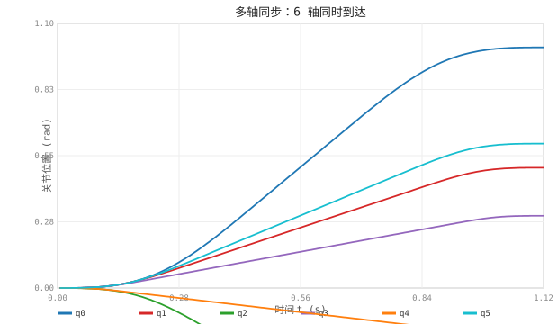
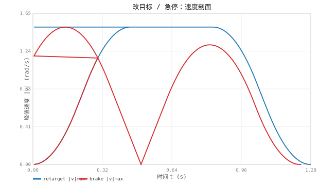

# F167.3 实时 OTG 演示（Ruckig，仿真-only 数值验证）

- 生成：`a3_trajectory_processing/otg_demo`（复用栈内 ruckig）；指标/SVG 由本脚本离线算。
- 不接生产 SERVO/teleop 50Hz 链路，纯数值演示。

| 场景 | 指标 | 值 |
|---|---|---|
| 多轴同步(Time) | 各轴到位时刻离散度 | 0.0 ms |
| 无同步(None) | 各轴到位时刻离散度 | 520.0 ms |
| 同步轨迹 | 峰值 v / a / jerk | 1.50 / 6.00 / 30.0 |
| 改目标 | 切换点速度跳变 max|Δv| | 0.0004 rad/s |
| 改目标 | 切换点速度(不停车) | 1.500 rad/s |
| 急停 | 制动时长 | 200.0 ms |
| 急停 | 制动距离(最大单关节) | 535.6 mrad |
| 急停 | 峰值 jerk | 30.5 rad/s³ |

## 多轴同步（6 轴同时到达）

## 改目标 / 急停速度剖面

- 判定：同步离散≈0 且 < 无同步；改目标速度连续且不停车；急停到零速 → PASS ✓
