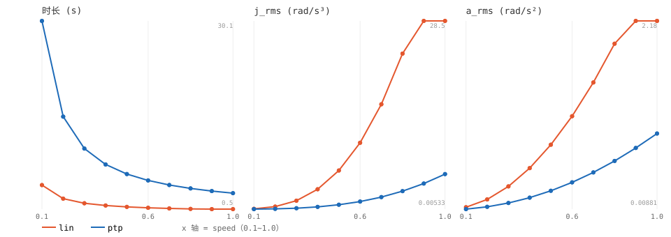

# 模式×速度扫描轨迹报告（sweep）

- 轨迹：sweep（F3↔C6 一来一回，ptp/lin × speed 0.1~1.0）
- 命令轨迹平滑度（vmax=1.5 rad/s, amax=15.0 rad/s²；lin 用笛卡尔 via 样条近似）

| mode | speed | 时长 s | j_rms rad/s³ | a_rms rad/s² |
|---|---|---|---|---|
| lin | 0.1 | 4.27 | 0.048 | 0.0302 |
| lin | 0.2 | 2.14 | 0.381 | 0.1206 |
| lin | 0.3 | 1.42 | 1.279 | 0.2710 |
| lin | 0.4 | 1.07 | 3.013 | 0.4812 |
| lin | 0.5 | 0.85 | 5.852 | 0.7512 |
| lin | 0.6 | 0.71 | 10.054 | 1.0805 |
| lin | 0.7 | 0.61 | 15.874 | 1.4691 |
| lin | 0.8 | 0.53 | 23.552 | 1.9165 |
| lin | 0.9 | 0.50 | 28.498 | 2.1789 |
| lin | 1.0 | 0.50 | 28.498 | 2.1789 |
| ptp | 0.1 | 30.05 | 0.005 | 0.0088 |
| ptp | 0.2 | 15.03 | 0.043 | 0.0352 |
| ptp | 0.3 | 10.02 | 0.144 | 0.0792 |
| ptp | 0.4 | 7.51 | 0.341 | 0.1409 |
| ptp | 0.5 | 6.01 | 0.665 | 0.2201 |
| ptp | 0.6 | 5.01 | 1.150 | 0.3172 |
| ptp | 0.7 | 4.29 | 1.824 | 0.4314 |
| ptp | 0.8 | 3.75 | 2.725 | 0.5639 |
| ptp | 0.9 | 3.33 | 3.879 | 0.7138 |
| ptp | 1.0 | 3.00 | 5.306 | 0.8799 |

> j_rms/a_rms 越小越平滑；时长反映速度缩放对运动时间的影响。
> 稳定性判定需结合仿真/真机的跟踪误差（见 melodion_sweep_run.py）。

