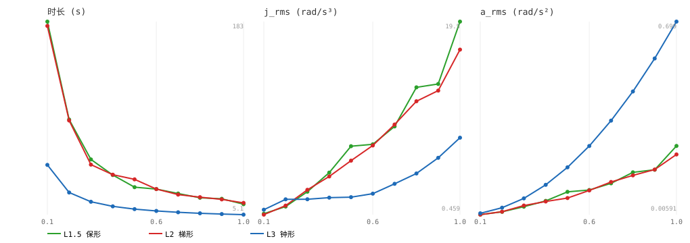

# 多路点轨迹模式基准对比（离线命令指标）

- 测试点：home_front, home_back, home_down（3 点，关节角）
- 模式：ptp 逐点 MoveJ, L1 blend, L2 梯形, L3 钟形, L1.5 保形
- vmax=1.5 rad/s, amax=15.0 rad/s²；speed 缩放 v/a

| mode | speed | 时长 s | j_rms rad/s³ | a_rms rad/s² |
|---|---|---|---|---|
| ptp 逐点 MoveJ | 0.1 | - | - | - |
| ptp 逐点 MoveJ | 0.2 | - | - | - |
| ptp 逐点 MoveJ | 0.3 | - | - | - |
| ptp 逐点 MoveJ | 0.4 | - | - | - |
| ptp 逐点 MoveJ | 0.5 | - | - | - |
| ptp 逐点 MoveJ | 0.6 | - | - | - |
| ptp 逐点 MoveJ | 0.7 | - | - | - |
| ptp 逐点 MoveJ | 0.8 | - | - | - |
| ptp 逐点 MoveJ | 0.9 | - | - | - |
| ptp 逐点 MoveJ | 1.0 | - | - | - |
| L1 blend | 0.1 | - | - | - |
| L1 blend | 0.2 | - | - | - |
| L1 blend | 0.3 | - | - | - |
| L1 blend | 0.4 | - | - | - |
| L1 blend | 0.5 | - | - | - |
| L1 blend | 0.6 | - | - | - |
| L1 blend | 0.7 | - | - | - |
| L1 blend | 0.8 | - | - | - |
| L1 blend | 0.9 | - | - | - |
| L1 blend | 1.0 | - | - | - |
| L2 梯形 | 0.1 | 179.27 | 0.4588 | 0.0059 |
| L2 梯形 | 0.2 | 92.03 | 1.3497 | 0.0165 |
| L2 梯形 | 0.3 | 51.25 | 2.9102 | 0.0385 |
| L2 梯形 | 0.4 | 41.96 | 4.2368 | 0.0531 |
| L2 梯形 | 0.5 | 37.70 | 5.7954 | 0.0655 |
| L2 梯形 | 0.6 | 28.72 | 7.2938 | 0.0929 |
| L2 梯形 | 0.7 | 23.63 | 9.3629 | 0.1232 |
| L2 梯形 | 0.8 | 21.24 | 11.6661 | 0.1470 |
| L2 梯形 | 0.9 | 19.19 | 12.7151 | 0.1677 |
| L2 梯形 | 1.0 | 15.93 | 16.7649 | 0.2222 |
| L3 钟形 | 0.1 | 51.04 | 0.9484 | 0.0108 |
| L3 钟形 | 0.2 | 25.52 | 1.9709 | 0.0308 |
| L3 钟形 | 0.3 | 17.01 | 1.9814 | 0.0644 |
| L3 钟形 | 0.4 | 12.76 | 2.1384 | 0.1130 |
| L3 钟形 | 0.5 | 10.21 | 2.1854 | 0.1757 |
| L3 钟形 | 0.6 | 8.51 | 2.5363 | 0.2525 |
| L3 钟形 | 0.7 | 7.29 | 3.5088 | 0.3434 |
| L3 钟形 | 0.8 | 6.38 | 4.5280 | 0.4481 |
| L3 钟形 | 0.9 | 5.67 | 6.0736 | 0.5667 |
| L3 钟形 | 1.0 | 5.10 | 8.0597 | 0.6990 |
| L1.5 保形 | 0.1 | 183.28 | 0.5501 | 0.0062 |
| L1.5 保形 | 0.2 | 92.86 | 1.2605 | 0.0162 |
| L1.5 保形 | 0.3 | 56.05 | 2.7244 | 0.0345 |
| L1.5 保形 | 0.4 | 41.70 | 4.6153 | 0.0553 |
| L1.5 保形 | 0.5 | 30.44 | 7.2248 | 0.0877 |
| L1.5 保形 | 0.6 | 28.69 | 7.4104 | 0.0943 |
| L1.5 保形 | 0.7 | 24.58 | 9.1793 | 0.1183 |
| L1.5 保形 | 0.8 | 20.69 | 13.0398 | 0.1578 |
| L1.5 保形 | 0.9 | 19.75 | 13.3718 | 0.1672 |
| L1.5 保形 | 1.0 | 14.76 | 19.5350 | 0.2525 |

> ptp/L1 依赖 move_group，命令指标需在线采集（traj_modes_run.py）。
> 平滑度排序预期：L3 钟形 < L1.5 保形 < L2 梯形（梯形加速度方波，冲击最大）。
> 统一标准 = 时长 + j_rms/a_rms（命令平滑度）+ 在线 peak_err/rms_err（跟踪）。

