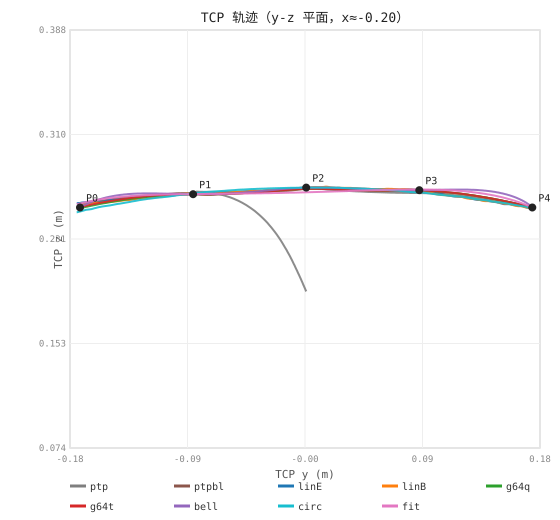
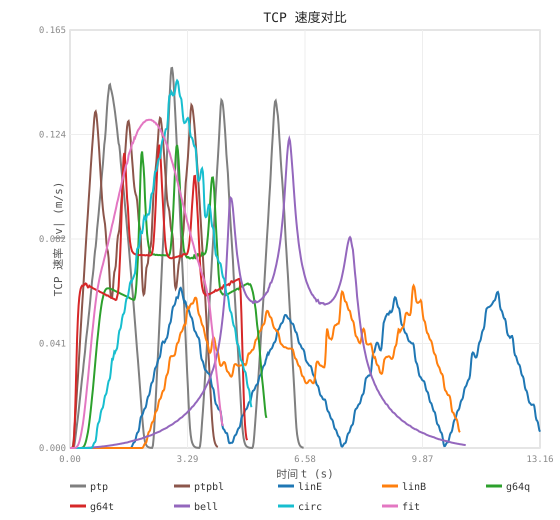
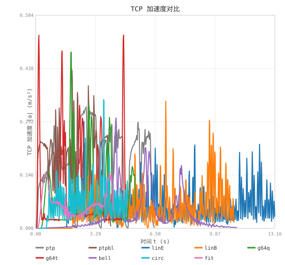

# 9 模式 TCP 轨迹对比（口风琴 5 点，实采）

- 采集：仿真栈逐模式回放，录制 /joint_states，Pinocchio FK 到 `end_effector`。
- 位置图：TCP 在 y-z 平面（x≈-0.20）轨迹，**等比例**；速度/加速度：TCP |v|/|a| vs 时间。
- 「距直线折线」= 各 TCP 点到 P0..P4 折线的最短垂距最大值（量化是否走直线）。

## 位置对比

## 速度对比

## 加速度对比

| 模式 | 时长(s) | TCP 峰值速率(m/s) | TCP 峰值加速度(m/s²) | TCP 路径长(m) | 距直线折线(mm) |
|---|---|---|---|---|---|
| ptp | 4.52 | 0.155 | 0.38 | 0.2620 | 2.6 |
| ptp_blend | 4.20 | 0.136 | 0.45 | 0.3424 | 4.1 |
| lin_exact | 13.18 | 0.061 | 0.30 | 0.3419 | 1.5 |
| lin_blend | 10.86 | 0.061 | 0.39 | 0.3405 | 2.9 |
| jnt_g64_quintic | 5.42 | 0.119 | 0.50 | 0.3422 | 2.3 |
| jnt_g64_trapezoid | 5.00 | 0.119 | 0.54 | 0.3420 | 3.3 |
| jnt_spline_bell | 11.16 | 0.122 | 0.31 | 0.3441 | 7.5 |
| circ | 5.20 | 0.146 | 0.30 | 0.3416 | 2.6 |
| jnt_spline_approx | 4.30 | 0.131 | 0.15 | 0.3418 | 4.8 |

