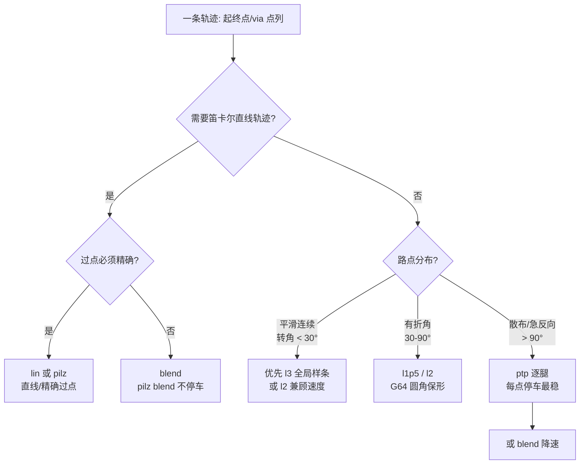

# 轨迹规划模式选型指南（F165 / F166）

本指南回答一个问题：**给定一条轨迹，该怎么选规划模式，做到「又快又稳」？**
配套工具：离线推荐器 `scripts/traj_mode_recommend.py`；离线 auto 规划器 `scripts/traj_plan_auto.py`（F166）。

## 1. 九种轨迹模式（F166 统一注册表 `arm_controller.TRAJ_MODES`）

每个模式有**规范名**与**旧名别名**（旧 stream 文件继续可用）。`resolve_traj_mode()` 解析。

| 规范名 | 别名 | 空间 | 路径 / 剖面 | 精确过点 | 工业对标 | 备注 |
|---|---|---|---|---|---|---|
| `ptp` | — | 关节 | OMPL+TOTG 逐腿 | ✅ 全部（逐点停） | KUKA PTP / ABB MoveAbsJ | 无 via 单腿或作多段逐腿；**有 via 时历史等价 `jnt_g64_quintic`** |
| `ptp_blend` | `ptp_seq` | 关节 | pilz PTP Sequence + blend | ❌（可逐点 blend=0） | KUKA PTP+blend | 不停车切角；F166 新增 stream 表达 |
| `lin_exact` | `pilz` | 笛卡尔 | pilz LIN Sequence, blend=0 | ✅ 全部（逐点停） | KUKA LIN / ABB MoveL | 需 pose |
| `lin_blend` | `lin`,`blend` | 笛卡尔 | pilz LIN Sequence + blend | ❌（可逐点 blend=0） | KUKA LIN+blend | 需 pose |
| `jnt_g64_quintic` | `l1p5` | 关节 | 折线 + **G64 圆角** / quintic 加-巡-减 | ❌（可逐点半径=0） | G64 连续路径 | 保形不过冲 |
| `jnt_g64_trapezoid` | `l2` | 关节 | 折线 + **G64 圆角** / 梯形 | ❌（可逐点半径=0） | G64 | 最省时 |
| `jnt_spline_bell` | `l3` | 关节 | 三次**插值**样条 / 钟形 | ✅ 全部（点间可能过冲） | KUKA SPLINE | 最平滑、无巡航偏慢 |
| `circ` | — | 笛卡尔 | **pilz CIRC 圆弧**（3 点定弧） | ✅（弧过中间点） | KUKA CIRC / ABB MoveC | 需 pose；辅助点放 `path_constraints(name=interim)` |
| `jnt_spline_approx` | `l3_fit` | 关节 | **逼近样条**（scipy 最小二乘）/ quintic | 仅端点（中间逼近不过点） | 拟合 B 样条 | 最平滑抗过冲、最快；点少时≈插值 |

> 关节模式（ptp/ptp_blend/l1p5/l2/l3/l3_fit）用 `positions`；笛卡尔模式（lin/pilz/blend/circ）用 `pose`。
> 「精确过点」列：`✅ 全部` = 每个 via 都精确到；`❌（可逐点…）` = 默认切角，但支持**逐点 exact**（见 §2）。

## 2. 逐点 exact（是否需要精确过点）

stream 段每个点可加 `exact: bool`（via 默认 false、target 默认 true）：

```yaml
segments:
  - mode: auto            # 规范名/别名，或 auto（离线解析）
    speed: 0.4
    via:
      - {positions: [...], exact: false}   # 可切角
      - {positions: [...], exact: true}    # 必须精确过点
    target: {positions: [...], exact: true}
```

- `exact: true` 的点 → 机理上置「blend 半径=0 / 圆角半径=0」→ 精确到位。
- 支持逐点的模式：`ptp_blend`/`lin_blend`/`jnt_g64_quintic`/`jnt_g64_trapezoid`；
  全精确：`ptp`/`lin_exact`/`jnt_spline_bell`；仅端点：`jnt_spline_approx`/`circ`。

## 3. 离线 auto 规划（`scripts/traj_plan_auto.py`）

```bash
python3 scripts/traj_plan_auto.py --config <plan.yaml> [--w-dur 0.5] [--w-j 0.5]
# 输出：<plan>.resolved.yaml（mode 已解析）+ <plan>.auto_report.md（各候选指标 + 选中理由）
```

对每段 `mode: auto`：按 exact 约束筛可行模式（`mode_exact_ok`）+ 空间兼容 → 离线预测各模式
时长/`j_rms`（软件模式用真实函数；MoveIt/pilz 模式用梯形代理）→ 归一化「时长/平滑」加权择优
（默认各 0.5）→ 写出最终 stream。运行时若仍是 `auto` → 保守兜底（全 exact→`jnt_spline_bell`；
含非 exact→`jnt_g64_trapezoid`）+ WARN。

## 4. 工业背景：拐角怎么处理（G64 连续路径）

关节折线在 via 点是**几何尖角**，`dq/ds` 不连续 → 时间参数化算出加速度尖峰 →
为守住 `amax` 把**整条**轨迹降速（F165 修复前 l1p5/l2 达 27-30s，物理下界仅 ~3.3s）。

工业做法（本仓已落地）：**G64 连续路径 / 拐角圆滑** —— 直线段保形，仅在拐角切一段
小半径圆角（二次 Bezier，C1 速度连续），既不改变直线段形状（保形、不过冲），又消除
加速度尖峰。对应参数 `goto_via_corner_blend_rad`（关节弧度，默认 0.15，`<=0` 关闭）。

F165 同时修复了 `_jerk_limited_timed_traj` 减速段的速度不连续 bug（原减速复用了加速段
quintic，导致巡航末速度从 `vmax` 突降到 0 → 假加速度尖峰 ≈ `v/(2·dt)`，使缩放循环把
速度压到 `~amax/50`）。

## 3. 关键实测（F165，口风琴 5 点键盘路径，speed=0.4）

| 模式 | 修复前 | 修复后 | 效率（实测/物理下界 S/vmax） |
|---|---|---|---|
| pilz | 9.5s | 9.5s | — |
| blend | 8.5s | 8.5s | — |
| l1p5 | 27s | **5.5s** | 1.16× |
| l2 | 30s | **4.9s** | 1.02× |
| l3 | 11.1s | 11.1s | 1.88×（= 钟形剖面固有峰均比） |

**读法**：`l2` 最省时（恒加速+巡航）；`l1p5` 次之（quintic 过渡更柔）；`l3` 恒定 1.88×
——这**不是 bug**，是钟形剖面（无巡航段）的固有代价，换来最平滑（j_rms 最低）。

## 4. 速度梯度（F165，5 模式 × speed 0.1/0.2/0.4/0.8）

实测前向段耗时（s）：

| 模式 | 0.1 | 0.2 | 0.4 | 0.8 |
|---|---|---|---|---|
| pilz | 29.9 | 19.4 | 14.5 | 10.6 |
| blend | 23.0 | 16.3 | 12.7 | 9.5 |
| l1p5 | 19.1 | 9.9 | 5.5 | 3.7 |
| l2 | 18.9 | 9.5 | 4.9 | 3.5 |
| l3 | 43.7 | 22.0 | 11.2 | 6.5 |

- 关节模式随 speed 近似线性（0.4→0.8 约 1.4-1.7×，未到理想 2× —— 高速段转为加速度/曲率受限，物理合理）。
- 笛卡尔 pilz/blend 现已单调下降（修复前 speed≥0.4 饱和：pilz 0.4/0.8 均 ~9.5s，因加速度未随 speed 缩放）。

## 5. 选型决策



**原则**：
- 平滑连续路径（键盘、直线摆渡）→ `l3`（最平滑）或 `l2`（最快）。
- 有折角但要保形不过冲 → `l1p5`/`l2`（G64 圆角）。
- 需要笛卡尔直线/精确点位 → `lin`/`pilz`；只求不停车 → `blend`。
- **散布点、急反向、真机大惯性** → `ptp` 逐腿（每点停车、无过冲、无速度突变）。

## 6. 为什么散布点不要盲目用 l3

- **过冲**：三次样条在孤立/急反向 via 点附近会 Runge 振荡。实测 10 个散布点
  （`melodion_*`/`home_*`/`ready`/`idle`/`snap_*` 混排，平均转角 137°）l3 过冲
  **0.489 rad**（>0.3 判不可行）；而 l1p5/l2 的 G64 圆角保形，过冲 0。
- **绕路/降速**：散布点让样条越长越绕，且拐角曲率大 → 时间参数化降速；实测同样
  10 点 l3 预测 125.9s，l1p5/l2 仅 112s、ptp 逐腿 23.6s。
- **真机惯性**：散布点意味着速度方向频繁突变，真机大惯性下 `ptp` 的「每点停车」
  反而最安全（速度可归零再起步）。

## 7. 离线推荐器用法

```bash
source scripts/a3_shell_env.sh
# 命名点位序列
python3 scripts/traj_mode_recommend.py --poses home_up,home_front,home_down,home_back --speed 0.4
# 路点文件 / stream
python3 scripts/traj_mode_recommend.py --waypoints trajectories/waypoints/latest.yaml
python3 scripts/traj_mode_recommend.py --stream scale
```

输出：各模式预测时长 / `a_rms` / `j_rms` / 过冲 / 是否可行 + 推荐（最快、最平滑）
+ 场景提示。纯离线（复用编排层同源纯函数 + Pinocchio 限位），无需 ROS 运行。

## 8. 相关文件

- 实现：`src/a3_arm_controller/a3_arm_controller/arm_controller.py`（`_round_corners`、
  `_jerk_limited_timed_traj`、`_goto_via_smooth`、`_build_lin_sequence_item`）
- 参数：`src/a3_arm_controller/config/arm_controller.yaml`（`goto_via_corner_blend_rad` 等）
- 生成器：`scripts/gen_stream_modes.py`（多模式对比）、`scripts/traj_mode_recommend.py`（推荐器）
- 契约：[shared/TOPIC_CONTRACT.md](../shared/TOPIC_CONTRACT.md)、[shared/CONTROL_ROADMAP.md](../shared/CONTROL_ROADMAP.md)
- 需求：[requirements/F165-trajectory-mode-industrial-optimization.md](requirements/F165-trajectory-mode-industrial-optimization.md)
