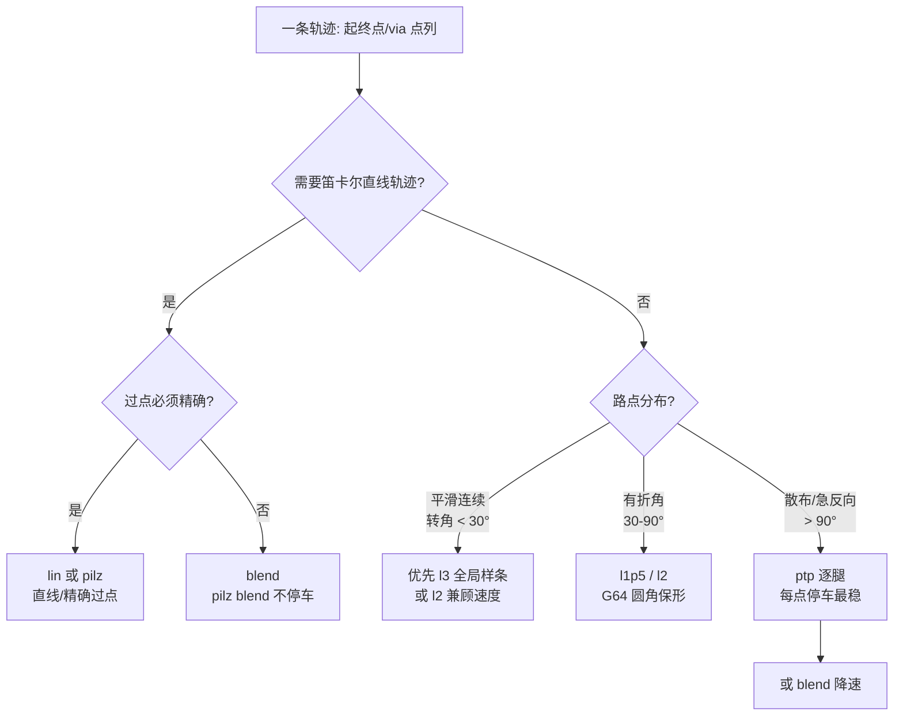

# 轨迹规划模式选型指南（F165 / F166）

本指南回答一个问题：**给定一条轨迹，该怎么选规划模式，做到「又快又稳」？**
配套工具：离线推荐器 `scripts/traj_mode_recommend.py`；离线 auto 规划器 `scripts/traj_plan_auto.py`（F166）。

## 1. 九种轨迹模式（F166 统一注册表 `arm_controller.TRAJ_MODES`）

每个模式有**规范名**与**旧名别名**（旧 stream 文件继续可用）。`resolve_traj_mode()` 解析。

| 规范名 | 别名 | 空间 | 路径 / 剖面 | 精确过点 | 工业对标 | 备注 |
|---|---|---|---|---|---|---|
| `ptp` | — | 关节 | OMPL+TOTG 逐腿 | ✅ 全部（逐点停） | KUKA PTP / ABB MoveAbsJ | 无 via 单腿或作多段逐腿；**有 via 时历史等价 `jnt_g64_quintic`** |
| `ptp_blend` | `ptp_seq` | 关节 | pilz PTP Sequence + blend | ❌（可逐点 blend=0） | KUKA PTP+blend | 不停车切角；F166 新增 stream 表达 |
| `lin_exact` | `pilz` | 笛卡尔 | pilz LIN Sequence, blend=0 | ✅ 全部（逐点停） | KUKA LIN / ABB MoveL | 需 pose |
| `lin_blend` | `lin`,`blend` | 笛卡尔 | pilz LIN Sequence + blend | ❌（可逐点 blend=0） | KUKA LIN+blend | 需 pose |
| `jnt_g64_quintic` | `l1p5` | 关节 | 折线 + **G64 圆角** / quintic 加-巡-减 | ❌（可逐点半径=0） | G64 连续路径 | 保形不过冲 |
| `jnt_g64_trapezoid` | `l2` | 关节 | 折线 + **G64 圆角** / 梯形 | ❌（可逐点半径=0） | G64 | 最省时 |
| `jnt_spline_bell` | `l3` | 关节 | 三次**插值**样条 / 钟形 | ✅ 全部（点间可能过冲） | KUKA SPLINE | 最平滑、无巡航偏慢 |
| `circ` | — | 笛卡尔 | **pilz CIRC 圆弧**（3 点定弧） | ✅（弧过中间点） | KUKA CIRC / ABB MoveC | 需 pose；辅助点放 `path_constraints(name=interim)` |
| `jnt_spline_approx` | `l3_fit` | 关节 | **逼近样条**（scipy 最小二乘）/ quintic | 仅端点（中间逼近不过点） | 拟合 B 样条 | 最平滑抗过冲、最快；点少时≈插值 |

> 关节模式（ptp/ptp_blend/l1p5/l2/l3/l3_fit）用 `positions`；笛卡尔模式（lin/pilz/blend/circ）用 `pose`。
> 「精确过点」列：`✅ 全部` = 每个 via 都精确到；`❌（可逐点…）` = 默认切角，但支持**逐点 exact**（见 §2）。
> 术语：**OMPL** = Open Motion Planning Library（采样式运动规划库，MoveIt 默认规划器 RRTConnect）。
> 本仓 `ptp` 单腿经 MoveIt/OMPL 规划**关节无碰路径**，再由 TOTG/Ruckig 赋时间律（故称「OMPL+TOTG」）。

### 1.1 使用场景速查（首末点固定，差别在"中间点怎么过"）

**端点语义（9 种一致）**：段首 = **当前实际位**（恒精确、无跳变），段末 = `target`（恒精确停）；
只有中间 `via` 点才可能不精确。「过点」由 `exact` 属性表达（见 §2）。

| 模式 | 中间点过点 | 最少配置点 | 典型使用场景 |
|---|---|---|---|
| `ptp` | 全过（逐点停） | 1 | 点位定位、示教逐段回放；要停稳/精确到点/大惯性急反向 |
| `ptp_blend` | 可逐点指定 | 2 | 关节快速多路点过渡（不停车）；不需笛卡尔直线 |
| `lin_exact` | 全过（逐点停） | 1 | 精密接触/压装、涂胶、焊接——要**直线且逐点停** |
| `lin_blend` | 可逐点指定 | 2 | 喷涂/巡边/码垛——要直线但拐角不停车 |
| `jnt_g64_quintic` | 可逐点指定 | 2 | 产线节拍 + 关节平滑连续路径（最通用的"顺滑过点"） |
| `jnt_g64_trapezoid` | 可逐点指定 | 2 | 节拍优先（最快），能接受加速度不连续 |
| `jnt_spline_bell` | 全过（点间可能过冲） | 2 | 要**精确过每个路点**且抖小（示教点严格重现） |
| `circ` | 过辅助点（弧过 3 点） | 2（恰好 1 辅助） | 圆弧：绕行、倒角、球面/圆周轨迹 |
| `jnt_spline_approx` | 全不过（仅端点） | 3（=via≥2） | 一批点求**最平滑逼近**、点不必严格过（去抖/去噪） |

### 1.2 最少点数要求与退化行为

「配置点」= 段内 `via` 数 + 1（`target`），**不含起点**。低于阈值会退化（不再体现该模式特色）：

| 模式 | 配置点 = 1（仅 target） | 配置点 = 2 | 配置点 ≥ 3 |
|---|---|---|---|
| `ptp` | 1 段 OMPL 单腿 ✅ | 2 段逐腿 | 多段逐腿 |
| `ptp_blend` | ⚠️ 退化为 OMPL 单段（非 pilz） | pilz PTP 序列 ✅ | ✅ |
| `lin_exact` | 单段 LIN ✅（即其特色） | 逐点精确停 ✅ | ✅ |
| `lin_blend` | ⚠️ 退化为单段 LIN | pilz LIN 序列 ✅ | ✅ |
| `jnt_g64_quintic` / `jnt_g64_trapezoid` | ⚠️ 退化为 OMPL 单段（无拐角可圆） | G64 圆角 ✅ | ✅ |
| `jnt_spline_bell` | ⚠️ 退化为 OMPL 单段 | 3 点样条 ✅ | ✅（过冲随点数增大） |
| `circ` | ⚠️ 退化为单段 LIN | **恰好 2 = 正常** | ❌ 报错（必须恰好 1 辅助点） |
| `jnt_spline_approx` | ⚠️ 退化为 OMPL 单段 | ⚠️ 退回插值样条（≈`jnt_spline_bell`） | ✅ 真·最小二乘逼近 |

> 原因：无 `via` 的段走 `_plan_single`（关节 → OMPL `_moveit_move`；笛卡尔 → `_lin_move`），
> 不进入该模式的手写路径生成器。所以**除 `ptp`/`lin_exact`/`circ` 外，要让模式特色生效至少要给 1 个 `via` 点**。

## 2. 逐点 exact（是否需要精确过点）

stream 段每个点可加 `exact: bool`（via 默认 false、target 默认 true）：

```yaml
segments:
  - mode: auto            # 规范名/别名，或 auto（离线解析）
    speed: 0.4
    via:
      - {positions: [...], exact: false}   # 可切角
      - {positions: [...], exact: true}    # 必须精确过点
    target: {positions: [...], exact: true}
```

- `exact: true` 的点 → 机理上置「blend 半径=0 / 圆角半径=0」→ 精确到位。
- 支持逐点的模式：`ptp_blend`/`lin_blend`/`jnt_g64_quintic`/`jnt_g64_trapezoid`；
  全精确：`ptp`/`lin_exact`/`jnt_spline_bell`；仅端点：`jnt_spline_approx`/`circ`。

## 3. 离线 auto 规划（`scripts/traj_plan_auto.py`）

```bash
python3 scripts/traj_plan_auto.py --config <plan.yaml> [--w-dur 0.5] [--w-j 0.5]
# 输出：<plan>.resolved.yaml（mode 已解析）+ <plan>.auto_report.md（各候选指标 + 选中理由）
```

对每段 `mode: auto`：按 exact 约束筛可行模式（`mode_exact_ok`）+ 空间兼容 → 离线预测各模式
时长/`j_rms`（软件模式用真实函数；MoveIt/pilz 模式用梯形代理）→ 归一化「时长/平滑」加权择优
（默认各 0.5）→ 写出最终 stream。运行时若仍是 `auto` → 保守兜底（全 exact→`jnt_spline_bell`；
含非 exact→`jnt_g64_trapezoid`）+ WARN。

## 4. 工业背景：拐角怎么处理（G64 连续路径）

关节折线在 via 点是**几何尖角**，`dq/ds` 不连续 → 时间参数化算出加速度尖峰 →
为守住 `amax` 把**整条**轨迹降速（F165 修复前 l1p5/l2 达 27-30s，物理下界仅 ~3.3s）。

工业做法（本仓已落地）：**G64 连续路径 / 拐角圆滑** —— 直线段保形，仅在拐角切一段
小半径圆角（二次 Bezier，C1 速度连续），既不改变直线段形状（保形、不过冲），又消除
加速度尖峰。对应参数 `goto_via_corner_blend_rad`（关节弧度，默认 0.15，`<=0` 关闭）。

F165 同时修复了 `_jerk_limited_timed_traj` 减速段的速度不连续 bug（原减速复用了加速段
quintic，导致巡航末速度从 `vmax` 突降到 0 → 假加速度尖峰 ≈ `v/(2·dt)`，使缩放循环把
速度压到 `~amax/50`）。

## 3. 关键实测（F165，口风琴 5 点键盘路径，speed=0.4）

| 模式 | 修复前 | 修复后 | 效率（实测/物理下界 S/vmax） |
|---|---|---|---|
| pilz | 9.5s | 9.5s | — |
| blend | 8.5s | 8.5s | — |
| l1p5 | 27s | **5.5s** | 1.16× |
| l2 | 30s | **4.9s** | 1.02× |
| l3 | 11.1s | 11.1s | 1.88×（= 钟形剖面固有峰均比） |

**读法**：`l2` 最省时（恒加速+巡航）；`l1p5` 次之（quintic 过渡更柔）；`l3` 恒定 1.88×
——这**不是 bug**，是钟形剖面（无巡航段）的固有代价，换来最平滑（j_rms 最低）。

## 4. 速度梯度（F165，5 模式 × speed 0.1/0.2/0.4/0.8）

实测前向段耗时（s）：

| 模式 | 0.1 | 0.2 | 0.4 | 0.8 |
|---|---|---|---|---|
| pilz | 29.9 | 19.4 | 14.5 | 10.6 |
| blend | 23.0 | 16.3 | 12.7 | 9.5 |
| l1p5 | 19.1 | 9.9 | 5.5 | 3.7 |
| l2 | 18.9 | 9.5 | 4.9 | 3.5 |
| l3 | 43.7 | 22.0 | 11.2 | 6.5 |

- 关节模式随 speed 近似线性（0.4→0.8 约 1.4-1.7×，未到理想 2× —— 高速段转为加速度/曲率受限，物理合理）。
- 笛卡尔 pilz/blend 现已单调下降（修复前 speed≥0.4 饱和：pilz 0.4/0.8 均 ~9.5s，因加速度未随 speed 缩放）。

## 5. 选型决策



**原则**：
- 平滑连续路径（键盘、直线摆渡）→ `l3`（最平滑）或 `l2`（最快）。
- 有折角但要保形不过冲 → `l1p5`/`l2`（G64 圆角）。
- 需要笛卡尔直线/精确点位 → `lin`/`pilz`；只求不停车 → `blend`。
- **散布点、急反向、真机大惯性** → `ptp` 逐腿（每点停车、无过冲、无速度突变）。

## 6. 为什么散布点不要盲目用 l3

- **过冲**：三次样条在孤立/急反向 via 点附近会 Runge 振荡。实测 10 个散布点
  （`melodion_*`/`home_*`/`ready`/`idle`/`snap_*` 混排，平均转角 137°）l3 过冲
  **0.489 rad**（>0.3 判不可行）；而 l1p5/l2 的 G64 圆角保形，过冲 0。
- **绕路/降速**：散布点让样条越长越绕，且拐角曲率大 → 时间参数化降速；实测同样
  10 点 l3 预测 125.9s，l1p5/l2 仅 112s、ptp 逐腿 23.6s。
- **真机惯性**：散布点意味着速度方向频繁突变，真机大惯性下 `ptp` 的「每点停车」
  反而最安全（速度可归零再起步）。

## 7. 离线推荐器用法

```bash
source scripts/a3_shell_env.sh
# 命名点位序列
python3 scripts/traj_mode_recommend.py --poses home_up,home_front,home_down,home_back --speed 0.4
# 路点文件 / stream
python3 scripts/traj_mode_recommend.py --waypoints trajectories/waypoints/latest.yaml
python3 scripts/traj_mode_recommend.py --stream scale
```

输出：各模式预测时长 / `a_rms` / `j_rms` / 过冲 / 是否可行 + 推荐（最快、最平滑）
+ 场景提示。纯离线（复用编排层同源纯函数 + Pinocchio 限位），无需 ROS 运行。

## 8. 相关文件

- 实现：`src/a3_arm_controller/a3_arm_controller/arm_controller.py`（`_round_corners`、
  `_jerk_limited_timed_traj`、`_goto_via_smooth`、`_build_lin_sequence_item`）
- 参数：`src/a3_arm_controller/config/arm_controller.yaml`（`goto_via_corner_blend_rad` 等）
- 生成器：`scripts/gen_stream_modes.py`（多模式对比）、`scripts/traj_mode_recommend.py`（推荐器）、`scripts/traj_plan_auto.py`（离线 auto 规划）
- 契约：[shared/TOPIC_CONTRACT.md](../shared/TOPIC_CONTRACT.md)、[shared/CONTROL_ROADMAP.md](../shared/CONTROL_ROADMAP.md)
- 学习清单：[control/03-trajectory.md](../control/03-trajectory.md)（轨迹规划与时间律「从简到难」进阶，本指南为其 T0–T11 的选型细节）
- 需求：[requirements/F165-trajectory-mode-industrial-optimization.md](requirements/F165-trajectory-mode-industrial-optimization.md)、
  [requirements/F166-trajectory-mode-registry-9mode-auto.md](requirements/F166-trajectory-mode-registry-9mode-auto.md)、
  [requirements/F167-trajectory-lib-upgrade-ruckig-toppra-otg.md](requirements/F167-trajectory-lib-upgrade-ruckig-toppra-otg.md)

## 9. 时间律来源：手写剖面 ↔ 成熟库（F167）

软件模式（`jnt_g64_quintic`/`jnt_g64_trapezoid`/`jnt_spline_bell`/`jnt_spline_approx`）的**几何路径**
为手写（G64 圆角 / scipy 样条），**时间律**可切换（参数 `goto_via_time_backend`）：

| 取值 | 时间律 | 说明 |
|---|---|---|
| `software`（默认） | 手写剖面（quintic / 梯形 / 钟形） | 平滑（j_rms 低）、进程内、零回归 |
| `totg` / `ruckig` | `/a3/arm/retime_trajectory`（成熟库） | **时间最优（bang-bang）**：更快（实测快 30-60%）但更"抖"（j_rms 高 2-8×）；服务不可用自动回退 `software` |

- 服务请求带逐关节**绝对** `velocity_limits/acceleration_limits`（复现 `goto_via_max_*` caps），几何路径不变。
- A/B 与结论见 [dev/F167_TRAJECTORY_LIB_UPGRADE_REPORT.md](../dev/F167_TRAJECTORY_LIB_UPGRADE_REPORT.md)。
- 另：离线力矩/动力学约束（toppra + Pinocchio）、实时 OTG（Ruckig）能力见 F167.2/F167.3。

## 10. `jnt_spline_approx` 与示教回放（F137+F68）的关系

两者是**同一思路「几何逼近/平滑 + 时间重定时」**在不同输入上的落地：

| 维度 | 示教/连续回放（`playback`，F137+F68） | `jnt_spline_approx`（`l3_fit`） |
|---|---|---|
| 输入 | **密集录制点**（拖动示教，几百~几千点） | **稀疏路点**（几个 `via`） |
| 几何 | 逐关节**五次** B 样条平滑去噪（`s=N·ε²`，RMS 残差 ≈ ε rad）；端点不强制 | **三次** B 样条最小二乘逼近（`ctrl_ratio=0.7`）；**端点强制精确** |
| 目的 | 去编码器量化锯齿、光顺 | 平滑逼近稀疏点、抗过冲 |
| 时间律 | F68 retime（TOTG/Ruckig，时间最优） | `_jerk_limited_timed_traj`（quintic 加-巡-减）；F167 可切 `totg`/`ruckig` |
| 下发 | JTC（C2 样条插值） | JTC |

**结论**：`jnt_spline_approx` 即「**稀疏路点版**的 F137」——都是 B 样条逼近 + retime。把
`goto_via_time_backend` 切到 `totg`/`ruckig` 后，其时间律与 F68 同源，二者链路基本等价。
差别在定位：F137 面向**密集录制**（去噪为主、端点可微改），`jnt_spline_approx` 面向**稀疏路点**（端点必须精确）。
