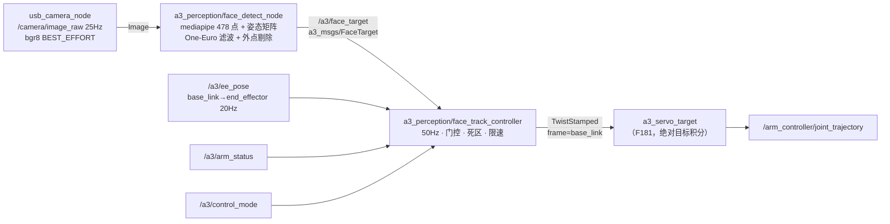

# F183 — 人脸跟踪视觉伺服（MediaPipe → 6DoF 目标 → Twist）

> **Status:** implemented-pending-hw（待真机联调）
> **分组:** 功能 / 视觉
> **关联:** F177（USB 相机）、F175（`/a3/ee_pose`）、F181（servo 绝对目标 + 平滑）、
> `docs/shared/TOPIC_CONTRACT.md`、`docs/shared/SAFETY.md`

## 1. 背景与目标

相机装在末端连杆上、光轴相对杆轴向下倾斜约 45°（eye-in-hand）。目标：**让相机光轴始终对准人脸**，
即"人脸中心保持在画面中心 + 距离保持在工作距离"，并输出头部转角供上层判断"是否正对"。

控制目标（已与用户确认）：**相机光轴对准脸**（不是让末端杆轴指向脸——几何上 45° 偏置会使脸落到
画面外约 45°，超出视野）。

两种能力的组合：
1. **检测侧（本需求）**：mediapipe FaceLandmarker 478 点 → 6 个控制参数
   X/Y/Z(mm) + YAW/PITCH/ROLL(deg，人脸朝向)，滤波后以话题发布。
2. **控制侧（本需求）**：跟踪控制器把目标转成相机系期望速度 → 旋转到 base 系 → `TwistStamped`
   发给 `a3_servo_target`（`/servo_node/delta_twist_cmds`）。

## 2. 实测结论（本机 RK3588，作为设计依据）

### 2.1 检测后端选型：MediaPipe 胜出

同机、同图（lena 640×480）、绑 2 核、三轮取最小值：

| 方案 | 输入 | 单帧 | 吞吐 | CPU | 输出 |
|---|---|---|---|---|---|
| YuNet 2022mar（cv2 4.5.4 DNN） | 640×480 | 84.8 ms | 11.8 fps | 0.91 核 | 5 点 |
| YuNet 2022mar | 320×240 | 17.7 ms | 56.5 fps | 1.13 核 | 5 点 |
| **MediaPipe FaceLandmarker** | 640×480 | **32.0 ms** | **31.3 fps** | 0.89 核 | 478 点（含虹膜） |

- YuNet 成本 ∝ 输入面积（OpenCV 4.5.4 的 DNN 在 aarch64 无 XNNPACK 级别优化）；MediaPipe 输入固定
  192/256，与外部分辨率基本无关，全分辨率下反而快 2.6×。
- 另：`face_detection_yunet_2023mar.onnx`（动态 shape）在 cv2 4.5.4 上直接报
  `Layer with requested id=-1 not found`，必须用 fixed-shape 的 2022mar。少一个外部依赖，
  但多一个版本耦合点。

**结论：用 MediaPipe**，实测视频端到端 56 ms/帧（≈17.8 fps，含 478 点绘制）。
ROS 节点在板子重载（load avg 22、4 个孤儿 `ee_pose` 进程）时实测 8 Hz；
干净栈下应按 ~17 Hz 复核（验收第 2 条）。

### 2.2 姿态求解：用 mediapipe 自带矩阵，不用手写 PnP

实拍视频（`capture/face/videos/vid_20261023_200148.avi`，640×480@25，768 帧）对比：

| 姿态源 | 正脸帧 yaw | 重投影误差 | 稳定性 |
|---|---|---|---|
| 手工 6 点模型 solvePnP（SQPNP） | ±47°（正负翻转） | 8–12 px | ❌ 近距（<0.5 m）出现镜像解 |
| `facial_transformation_matrixes` | ±6° 内 | — | ✅ 与画面朝向一致 |

yaw 符号已用极端帧验证：头向画面右转 → +57.4°；向左转 → −53.5°。
即 **yaw>0 = 人脸朝画面右，pitch>0 = 抬头，roll>0 = 头向画面右下歪**（roll 用双眼连线在图像里求）。

### 2.3 单目绝对深度必须标定

自带矩阵的平移量是人脸规范模型单位，不是真实毫米：本段视频按 cm 解释得 340 mm，按外眼角
90 mm 反推为 460–490 mm。**必须做一次单点标定**（脸放已知距离 D，读当前 Z 得 R，令
`units_mm × R/R' = D`）。标定后深度误差主要来自个体脸型差异（±10%）与转头时的透视缩短，
作为伺服外环（不追求 mm 级）足够。

### 2.4 环境约束（都会直接导致节点起不来）

1. mediapipe 依赖链 `mediapipe → solutions → drawing_utils → matplotlib` 会撞上系统
   `pyparsing 2.4.7`（venv 里装了 3.3.3 也没用），因为 `a3_shell_env.sh` 把
   `/usr/lib/python3/dist-packages` 排在 venv 前面。**必须在 PYTHONPATH 前**插入 venv 的
   site-packages，不能 `env -u PYTHONPATH`（那会丢 rclpy）。
2. 依赖体积：venv 731 MB（jaxlib 280 MB + jax 22 MB + opencv-contrib 64 MB），且 numpy 被换成
   1.26.4。故**只在检测节点用 venv**，控制器走系统 python。
3. 与 200 Hz 控制环共存：检测节点常驻 0.9 核；MQTT 桥自 2026-10-23 起**默认关**
   （`a3_bringup.launch.py use_mqtt=false` / `a3_stack.sh --mqtt` 才开），需要 web 遥测时再开
   （见 LL-180：MQTT 常驻 30~57% CPU 会挤出 feedback stale → freeze-hold）。
   真机实测：`motor 6` 反馈超时 46 次、`motor 1` 连续丢帧 189 s → 硬件接口长期 freeze-hold，
   这期间 jog/servo 全部被拒（报 `protective freeze-hold active`）。

## 3. 架构



检测与控制在**两个进程**：检测跑在 `~/.a3/venv/face_track`（mediapipe），控制器跑系统 python
（rclpy 原生环境，不受 numpy 1.26 影响）。

## 4. 接口契约

### 4.1 新消息 `a3_msgs/msg/FaceTarget`

| 字段 | 类型 | 说明 |
|---|---|---|
| `header` | `std_msgs/Header` | `frame_id=camera_optical_frame`，取图像时间戳 |
| `detected` | `bool` | 本帧是否检出（含 coasting 期） |
| `valid` | `bool` | 滤波后可用于控制（coasting 超时后为 false） |
| `confidence` | `float32` | 检测置信度 0–1 |
| `center_norm` | `geometry_msgs/Point` | 滤波后人脸中心，归一化 [0,1]（z 未用） |
| `xyz_mm` | `geometry_msgs/Point` | 相机光学系，滤波后，毫米 |
| `yaw_deg` `pitch_deg` `roll_deg` | `float32` | 人脸朝向（见 2.2 符号约定） |
| `image_error` | `geometry_msgs/Point` | 归一化误差 [-1,1]（x/y 分别除以半宽/半高） |
| `bbox_w_norm` `bbox_h_norm` | `float32` | 人脸包围盒宽高（归一化） |
| `track_age_s` | `float32` | 本次连续跟踪时长 |

### 4.2 话题 / 服务

| 名称 | 类型 | 方向 | 说明 |
|---|---|---|---|
| `/camera/image_raw` | `sensor_msgs/Image` | 订阅 | F177，bgr8 640×480@25，BEST_EFFORT |
| `/a3/face_target` | `a3_msgs/FaceTarget` | 发布 | 检测结果（约 18 Hz），RELIABLE depth 10 |
| `/a3/face_track/debug_image` | `sensor_msgs/Image` | 发布 | 标注图（`debug_image:=true`；`a3_stack.sh --face-track` 默认开，`--no-face-debug` 可关） |
| `/a3/face_track/enable` | `std_srvs/SetBool` | 服务 | 使能跟踪（默认 **false**，必须显式打开） |
| `/a3/face_track/reload_jacobian` | `std_srvs/Trigger` | 服务 | 重读 `~/.a3/camera/face_jacobian.yaml`（标定后热加载） |
| `/servo_node/delta_twist_cmds` | `geometry_msgs/TwistStamped` | 发布 | 50 Hz，`frame_id=base_link` |

### 4.3 控制律

记：`k=(fx,fy,cx,cy)` 内参（无内参时用 `hfov` 估算），`(u,v)` 滤波后人脸中心，`z` 深度，
`z_ref` 期望距离。**横向（左右/上下）+ 前后（固定距离）都跟踪。**

两种映射，`mapping` 选择（`auto` = 有标定文件用雅可比，否则解析外参）：

```
# A. 实测雅可比 + 标定帧（v2，推荐，见 §6.3）
v_lat  = -kp · J⁻¹ · [e_u, e_v] · clip(Z/Z0, 0.5, 2.5)   # J: 标定帧 Y/Z 两列
v_cal  = [ depth_dir · kz · (z_ref - Z),  v_lat_Y,  v_lat_Z ]
v_base = R_base_ee(now) · R_calᵀ · v_cal                 # 随末端姿态旋转

# B. 解析外参（未标定时的 fallback）
[X, Y, Z] = [(u-cx)·z/fx, (v-cy)·z/fy, z]               # 相机系，mm
e_xy      = max(|u-cx|/W, |v-cy|/H)                     # 归一化像素误差
v_cam     = [ kp·X/1000, kp·Y/1000, kz·(Z-z_ref)/1000 ] # m/s，死区内置 0
R_base_cam= R_base_ee(/a3/ee_pose) · R_ee_cam(45° 外参)
v_base    = R_base_cam · v_cam
```

共同约束：`|v| ≤ v_max`，逐拍斜坡 ≤ 0.5 m/s²。

**为什么用标定帧（v2）**：J 是在某个末端姿态下标定的。相机固定在末端上，L1 转动后
"画面右/后退"的方向会跟着转；若仍按基座 Y/Z 解释，就会把左右指令打到前后轴上，
表现为"跟不动/乱晃"。`R_cal` 在标定时记录，运行时用 `R_now · R_calᵀ` 旋转，
所以任意姿态下都成立。`depth_dir` 由标定时沿基座 +X 的深度探针实测（+1 = +X 远离）。

- 死区：`e_xy < deadband`（默认 6% 画幅，出死区 8% 滞环）且 `|dz| < 40 mm` → 输出 0
  （防抖，避免"围着目标抖"）。深度死区大于横向：`z` 的噪声/多径更明显。
- 增益（2026-10-24 真机定档）：`kp=0.4`、`kz=0.6`、`v_max=0.02 m/s`。此前 `0.9/0.05`
  + 小死区时两个环会同时饱和成 bang-bang，在目标附近来回摆（末端 z 摆 ±3.5 cm、误差摆 ±0.27）；
  降增益并加大死区后静止误差 std ≤ 0.001、末端 std 0.004 m。

### 4.4 安全门控（全部满足才发非零 twist）

| 条件 | 参数 |
|---|---|
| `SetBool(true)` 已使能 | `/a3/face_track/enable` |
| `arm_status.state ∈ {READY, SERVO}` | — |
| `control_mode != ZERO_TORQUE` | — |
| 目标新鲜度 < 0.5 s 且 `valid=true` | `target_timeout` |
| 距离在 `[z_min, z_max]` = [0.15, 0.90] m | `z_min` / `z_max` |
| `/a3/ee_pose` 可用（<0.5 s） | 用于 `R_base_ee` |

任一条件失效 → 立即发 0 并进入 hold；恢复需重新满足条件（不自动重新使能）。
Control 侧还有失能服务、Ctrl-C 归零；`a3_servo_target` 自身还有 0.3 s twist 超时与工作空间夹紧。

### 4.5 防「目标跑飞」（2026-10-24 真机事故后加）

现象：平板放到画面下沿（`center_norm y=0.71`），机械臂大幅抖动、疑似"暴动"，伺服日志：

```
err=736.0mm  z=0.0200  ik_fail=16446/44570  ik_jump_rej=2581  moving=1  |v|=0.200
```

根因链：图像误差大 → 控制器持续 −Z → `a3_servo_target` 的积分目标被夹到 z=0.02 m（基座附近，
当前 x 下够不到）→ 37% 周期 IK 失败、CLIK 在解之间跳 → 抖动。原先的虚拟墙只看 `ee_pose`（实测），
目标跑飞时实测还停在原地，所以从未触发。

三道护栏（本需求实现）：

| 护栏 | 参数 | 行为 |
|---|---|---|
| 目标估计 + 虚拟墙 | `workspace_min`/`max`、`workspace_margin_m` | 控制器自己累计"伺服目标"（实测 + ∫v），墙作用在目标上 |
| 追不动保护 | `stall_window_s=1.5`、`stall_min_progress=0.05`、`stall_v_frac=0.5`、`stall_hold_s=0.6` | 窗口内 \|e\| 不降且输出饱和 → 停发 0.6 s（> servo twist_timeout 0.3 s）强制重锚实测 |
| servo 侧目标夹紧 | `a3_bringup.launch.py` → `workspace_min=[-0.55,-0.45,0.15]` | 目标永远不会低于 z=0.15 m |

使用约束：平板尽量保持在画面中心 ±20%，不要放到画面下沿 20% 以外（那是俯仰工作区的边缘）。

### 4.6 转动跟踪（绕 base 跟人走，2026-10-24 追加）

默认 `enable_angular=false`（只平移，不引入腕部奇异）。纯平移只能覆盖 ±20–30°：
人脸绕 base 转 θ 时需要横向位移 `R·sinθ`（0.8 m 处 30° 就要 0.4 m），超出工作空间必丢目标。
要跟一圈必须转动末端：

```
w_cal  = [0, -ka·e_v, -ka·e_u]         # 标定帧：绕 Y=pitch，绕 Z=yaw
w_base = R_base_ee(now) · R_calᵀ · w_cal
```

- 符号推导（小孔成像）：`du/dt ≈ -ω_y`、`dv/dt ≈ +ω_x`；换算到标定帧后即上式。
  实测若发散，把 `ka` 取负即可。
- 限幅 `w_max=0.15 rad/s`、斜坡 `w_ramp=0.4 rad/s²`（2026-10-24 由 0.6/2.0 收紧，见 F187）；
  开转动时平移增益乘 `lin_frac=0.5`（转为主、平移补残差），避免双环叠加过冲。
- 转动覆盖范围受腕部限位（L4/L5/L6）与奇异限制，实际可用角度需真机验证。
- **安全门（F187）**：转动/平移闭环在"某关节已顶到限位"时会继续积分 → IK 换支 → 拖过限位堵转。
  现由 [F187](F187-servo-joint-limit-guard.md) 的关节限位软门兜底（`joint_guard` / `joint_margin_deg`）；
  默认参数已收紧为 `ka=0.3 / w_max=0.15 / w_ramp=0.4`。**2026-10-24 两次堵转事故**
  见 [LL-185](../../lessons_learned/LL-185-servo-joint-limit-stall-two-incidents.md)。

**几何约束（必须知道）**：相机光轴与第六轴 z 轴差约 45°（支架）。所以"第六轴 z 轴垂直人脸"
与"人脸在画面中心"不能同时成立。本需求的跟踪目标是**光轴对准人脸**；若要让工具 z 轴对准，
必须把相机支架改成与杆轴平行，或额外输出 45° 补偿姿态。

### 4.7 俯仰辅助 pitch_assist（高度受限时用转代替平移，2026-10-24 追加）

典型场景：人要抬高，末端需要继续上升，但已经顶到可达高度（IK 无解 / 虚拟墙 `z+`），
臂卡住不动。此时**抬腕**（绕标定帧 Y 的 pitch）就能让相机继续看向人脸，而不必再抬末端。

- 默认 `pitch_assist=false`，需先标定角雅可比并确认真机符号后再开。
- 触发（同时满足）：`pitch_assist` 开、`enable_angular=false`（不与整体转动环叠加）、
  `|e_v| > deadband_exit`、且**竖向平移受限**——本拍虚拟墙包含 `z±`，或最近
  `pitch_stall_window_s`（默认 2 s）内触发过"追不动"。
- 输出：`w_pitch = clip(-pitch_gain·e_v, ±pitch_max)`（默认 0.5 1/s、0.35 rad/s），
  经 `R_now·R_calᵀ` 转到 base 后叠加到 `w_des`。
- 与追不动保护的关系：保护负责"停发重锚"避免硬顶，pitch 辅助负责"换一个关节继续追"。

### 4.8 servo 端旋转语义（A 步骤，2026-10-24 修复）

`a3_servo_target` 原先用 `d = Isometry(R(w·dt), v·dt)` 左乘目标，纯角速度时位置会绕**基座原点**画弧，
末端点被甩动，且 `hold_z_` 会把弧线拉平，导致目标位姿自相矛盾 → IK 连续失败、残差涨到 700 mm。

- 现改为**绕末端点旋转**：`cand.linear() = R(w·dt)·target.linear()`，位置只由线速度平移；
  `rotation_about_tip:=false` 可回退旧行为。
- IK 失败/换支被拒时，目标**回退到最近成功位姿**（`target_ok_`），不再继续积分。
- **本拍转角必须是 `|w|·dt_step`**（2026-10-24 修）：原先 `th = w.norm()` 漏乘 `dt_step`，
  目标姿态每 10 ms 前进 `|w|` 弧度（≈100 倍速）→ CLIK 追不上、每拍判"换支/远离实测"回退，
  实测超转 2~4 倍且**与指令时长无关**（指令 0.10 rad 走出 0.394，减半仍 0.353）。详见 LL-183。
- 验收脚本：`scripts/a3_test/f183_servo_rotation_check.py`
  （三轴正负定向 6 次 + 随机 60 s；判定位置漂移 < 5 mm、角度误差 < 25%、回位 < 5 mm）。
  **真机 home 位形结果（2026-10-24）**：定向 6/6 通过（实测 0.099–0.110 rad / 指令 0.100，
  轴向 dot 1.00，位置漂移 0.3–3.7 mm）；随机相位逐段 13.0–13.2°/12.9°，累计约 26–31° 后
  **L4 触运动学限位（下界 −1.0472 rad = −60°）** 提前结束——home 是全伸位形，绕末端点做纯姿态旋转需整臂重构
  保持末端不动，L4 会先到限位（该关节限位不对称：−60°…+90°），属机构限制（大幅旋转验收请从半折位形起）。


## 5. 滤波取舍（用户提问：位置平均 vs 卡尔曼）

- **当前位置与目标取平均 = 一阶低通**，带来 `τ` 量级滞后，且有"移动中恒定落后"的问题；
  叠在已经有 0.06 s 低通 + 加速度限幅的 servo 内环上会**双重滞后**。
- **卡尔曼**需要明确的运动模型与噪声统计；人脸在图像里是"跟随机械臂运动的闭环对象"，
  过程噪声随动作剧变，模型难定，调参成本高于收益。
- 采用 **One-Euro**（低通 + 速度自适应截止）：静止时强平滑（去抖），快速转头时截止频率自动抬高
  （不滞后）。实测二阶差分抖动 u 2.02→0.83 px、v 3.64→2.20 px。
- 另加：跳变剔除（中心跳 >25% 画宽 → 重置滤波）、coasting（丢帧 0.3 s 内沿用上次值但置
  `valid=false`）——避免"检测抖一下机械臂就抽一下"。

## 6. 深度与 45° 外参标定

### 6.1 深度（必做一次）

```bash
# 把脸放到 200 mm 处（用尺量），跑离线标注脚本读 Z 中位数
env -u PYTHONPATH ~/.a3/venv/face_track/bin/python scripts/face_landmark_overlay.py \
    <video.avi> --units-mm 10 --z-ref 0.20
# 若读数 R=340，则 units_mm = 10 × 200/340 ≈ 5.9，填入 ~/.a3/camera/face_calib.yaml
```
`~/.a3/camera/face_calib.yaml` 覆盖包内默认值（`<pkg>/config/face_track.yaml`）。

### 6.2 解析外参（fallback，FK 反推 + 真机确认）

`cam_rpy_deg: [135, 0, 0]` —— 2026-10-23 由 FK + 真机方向观测反推（旧值 `[135,-52.9,0]` 会让画面歪约 43°、竖向推错）：

| 画面方向 | 对应基座轴 |
|---|---|
| 画面右 | **+Y** |
| 画面上 | **+Z** |
| 光轴/前后 | **−X**（home 位形；v2 起用于固定距离跟踪，方向由 `depth_dir` 实测） |

home 的 `L4=0` 时相机到底座连杆约 45° 下偏（用户实测支架约 60°，按 45° 近似即可），
相机正对桌面 → 适合用桌上平板里的脸做标定。该值只在未标定雅可比（`mapping=extrinsic`
或标定文件缺失）时生效；方向反了就把第一个数取反。

### 6.3 图像雅可比自标定（方法 A，推荐）

不依赖相机安装角/外参：在标定姿态下实测「基座 Y / Z 各走 30 mm → 画面中心移动多少」得到 2×2 雅可比，
再沿 +X 走一次量深度变化方向。安装角、偏置、尺度、左右/上下耦合全部被 J 吸收。
**任意装配方式都可，换支架只需重标一次。**

```bash
# 前置：arm_status=READY、跟踪未使能、脸/平板居中且 20 s 内不动
python3 scripts/a3_test/f183_calib_jacobian.py              # 约 18 s，探针 20 mm
python3 scripts/a3_test/f183_calib_jacobian.py --probe 0.03 # 条件数偏大时加大探针重标
# 输出 ~/.a3/camera/face_jacobian.yaml：
#   frame: cal, jacobian(2×2), r_base_ee(9), distance_mm(Z0), depth_dir(±1)
ros2 service call /a3/face_track/reload_jacobian std_srvs/srv/Trigger   # 热加载
```

脚本会打印 det / cond：`|det| < 1e-3` 判退化（两轴对画面影响几乎平行），`cond > 25` 建议加大探针。

**实测记录（2026-10-24，真机 6J，home 位形，Pad 脸，`--probe 0.03`）：**

```
J = [-4.4 -0.4; -0.9 +3.4] /m    det = -15.4    cond = 1.3    Z0 = 883 mm
```

- `du/dY < 0`：基座 +Y → 画面左移（即人脸在画面右侧时往 +Y 追，与真机直觉一致）。
- `dv/dZ > 0`：基座 +Z → 画面下移（人脸偏上时往 +Z 抬）。
- 串扰小、`cond≈1.3`，说明 Y/Z 两个方向几乎正交，可直接用 `J⁻¹` 解耦。
- Z0=883 mm 偏远（人站得比较靠后）；若日常跟踪距离在 0.6 m 左右，靠近后 `Z/Z0` 会自动缩小增益，
  也可在 0.6 m 处重标一次让基线更贴近常用工况。

### 6.4 前后（固定距离）跟踪与 X 轴

**已实现（v2）**：按 `z_ref` 保持距离——脸太近就沿光轴反方向后退，太远就靠近。
`z_ref_m <= 0` 时沿用标定距离 `Z0`（默认行为）。

- 方向不是写死的基座 ±X，而是**标定帧 X 轴**，运行时按 `R_now · R_calᵀ` 旋转：
  home 位姿下沿 X，L1 转 90° 后自动变成沿 ±Y。
- `depth_dir` 由标定实测（+1 = 沿 +X 走时人脸变远），避免猜符号。
- 前馈量 `v_x = depth_dir · kz · (z_ref − Z)`，死区 `dz_deadband_mm`（默认 20 mm），限速同 `v_max`。
- 距离变化对横向增益的影响仍由 `J ∝ 1/Z` 的 `Z/Z0` 缩放补偿；两者独立。
- 精度取决于单目深度标定（§6.1，个体脸型差异 ±10%），作为外环足够；不追求 mm 级。


## 7. 实现清单

| 文件 | 内容 |
|---|---|
| `src/a3_msgs/msg/FaceTarget.msg` | 新消息 |
| `src/a3_msgs/CMakeLists.txt` | 注册消息 |
| `src/a3_perception/` | 新 ament_python 包（检测节点、跟踪控制器、config、launch、README） |
| `scripts/setup_face_track_env.sh` | 建 `~/.a3/venv/face_track`、装 mediapipe、下模型到 `~/.a3/models/` |
| `scripts/a3_stack.sh` | `--face-track`：起栈后顺带拉起跟踪；`stop/restart` 先停它再停栈；`status` 单列一节；孤儿清理名单已含三个进程特征 |
| `scripts/face_landmark_overlay.py` | 离线视频验证/标定工具（已完成） |
| `scripts/a3_test/f183_calib_jacobian.py` | 图像雅可比自标定（Y/Z 探针 → `~/.a3/camera/face_jacobian.yaml`，含 `distance_mm`） |
| `docs/shared/TOPIC_CONTRACT.md` | 登记 `/a3/face_target`、`/a3/face_track/*` |

## 8. 验收标准

| # | 项 | 判据 | 方式 |
|---|---|---|---|
| 1 | 检测率 | 正常光照、0.3–0.8 m 单脸，≥95% 帧检出 | 离线视频 / debug 图 |
| 2 | 出帧率 | ≥12 Hz（640×480 输入） | `ros2 topic hz /a3/face_target` |
| 3 | 静止抖动 | 人不动 10 s：中心像素二阶差分 RMS < 1.5 px | 离线脚本统计 |
| 4 | 深度标定 | 20 cm 与 50 cm 两点读数误差 < 15% | 尺量 + 读数 |
| 5 | 转角 | 正脸 yaw 偏差 < ±8°；极端转头符号正确 | 视频抽查 |
| 6 | 闭环居中 | 人慢速左右移动（≤0.2 m/s），稳态图像误差 < 5% 画幅 | debug 图 + 记录 |
| 6b | 雅可比标定 | `f183_calib_jacobian.py` 成功写文件，`det≠0`、`cond<25`；`reload_jacobian` 日志显示 `Z0` | 标定输出 |
| 6c | 距离适应 | 在同一姿态下前/后移动 0.5→0.8 m，靠近不过冲、远离不迟钝（Z/Z0 缩放生效） | 实测 |
| 7 | 失能/丢脸 | 丢脸 0.3 s 内 twist 归零；失能后不再发非零 twist | 录 twist 话题 |
| 8 | 不干扰他模式 | 未使能时 `a3_servo_target` 收不到本控制器任何非零 twist | 同上 |

## 9. 不做（本需求边界）

- 多人脸 / 身份识别 / 表情与注意力判断。
- NPU（RKNN）加速：等控制律定型后再替换检测前端，接口不变。
- 绝对位姿对准（`/a3/move_to_pose`）、手眼 TSAI 标定（F150）、语音指令（F157）。
- 自动接管门禁/使能：跟踪只在 READY + 显式使能下工作，不改变编排层状态机。
