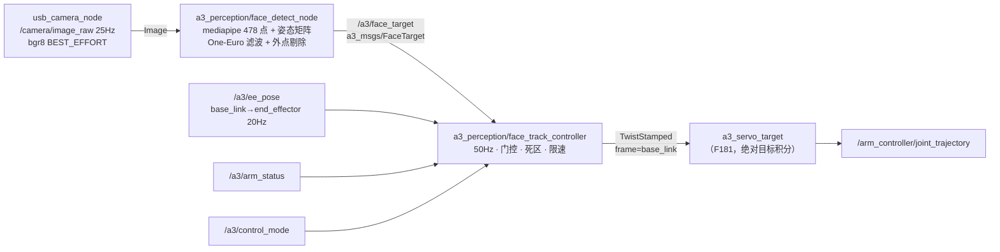

# F183 — 人脸跟踪视觉伺服（MediaPipe → 6DoF 目标 → Twist）

> **Status:** implemented-pending-hw（待真机联调）
> **分组:** 功能 / 视觉
> **关联:** F177（USB 相机）、F175（`/a3/ee_pose`）、F181（servo 绝对目标 + 平滑）、
> `docs/shared/TOPIC_CONTRACT.md`、`docs/shared/SAFETY.md`

## 1. 背景与目标

相机装在末端连杆上、光轴相对杆轴向下倾斜约 45°（eye-in-hand）。目标：**让相机光轴始终对准人脸**，
即"人脸中心保持在画面中心 + 距离保持在工作距离"，并输出头部转角供上层判断"是否正对"。

控制目标（已与用户确认）：**相机光轴对准脸**（不是让末端杆轴指向脸——几何上 45° 偏置会使脸落到
画面外约 45°，超出视野）。

两种能力的组合：
1. **检测侧（本需求）**：mediapipe FaceLandmarker 478 点 → 6 个控制参数
   X/Y/Z(mm) + YAW/PITCH/ROLL(deg，人脸朝向)，滤波后以话题发布。
2. **控制侧（本需求）**：跟踪控制器把目标转成相机系期望速度 → 旋转到 base 系 → `TwistStamped`
   发给 `a3_servo_target`（`/servo_node/delta_twist_cmds`）。

## 2. 实测结论（本机 RK3588，作为设计依据）

### 2.1 检测后端选型：MediaPipe 胜出

同机、同图（lena 640×480）、绑 2 核、三轮取最小值：

| 方案 | 输入 | 单帧 | 吞吐 | CPU | 输出 |
|---|---|---|---|---|---|
| YuNet 2022mar（cv2 4.5.4 DNN） | 640×480 | 84.8 ms | 11.8 fps | 0.91 核 | 5 点 |
| YuNet 2022mar | 320×240 | 17.7 ms | 56.5 fps | 1.13 核 | 5 点 |
| **MediaPipe FaceLandmarker** | 640×480 | **32.0 ms** | **31.3 fps** | 0.89 核 | 478 点（含虹膜） |

- YuNet 成本 ∝ 输入面积（OpenCV 4.5.4 的 DNN 在 aarch64 无 XNNPACK 级别优化）；MediaPipe 输入固定
  192/256，与外部分辨率基本无关，全分辨率下反而快 2.6×。
- 另：`face_detection_yunet_2023mar.onnx`（动态 shape）在 cv2 4.5.4 上直接报
  `Layer with requested id=-1 not found`，必须用 fixed-shape 的 2022mar。少一个外部依赖，
  但多一个版本耦合点。

**结论：用 MediaPipe**，实测视频端到端 56 ms/帧（≈17.8 fps，含 478 点绘制）。
ROS 节点在板子重载（load avg 22、4 个孤儿 `ee_pose` 进程）时实测 8 Hz；
干净栈下应按 ~17 Hz 复核（验收第 2 条）。

### 2.2 姿态求解：用 mediapipe 自带矩阵，不用手写 PnP

实拍视频（`capture/face/videos/vid_20261023_200148.avi`，640×480@25，768 帧）对比：

| 姿态源 | 正脸帧 yaw | 重投影误差 | 稳定性 |
|---|---|---|---|
| 手工 6 点模型 solvePnP（SQPNP） | ±47°（正负翻转） | 8–12 px | ❌ 近距（<0.5 m）出现镜像解 |
| `facial_transformation_matrixes` | ±6° 内 | — | ✅ 与画面朝向一致 |

yaw 符号已用极端帧验证：头向画面右转 → +57.4°；向左转 → −53.5°。
即 **yaw>0 = 人脸朝画面右，pitch>0 = 抬头，roll>0 = 头向画面右下歪**（roll 用双眼连线在图像里求）。

### 2.3 单目绝对深度必须标定

自带矩阵的平移量是人脸规范模型单位，不是真实毫米：本段视频按 cm 解释得 340 mm，按外眼角
90 mm 反推为 460–490 mm。**必须做一次单点标定**（脸放已知距离 D，读当前 Z 得 R，令
`units_mm × R/R' = D`）。标定后深度误差主要来自个体脸型差异（±10%）与转头时的透视缩短，
作为伺服外环（不追求 mm 级）足够。

### 2.4 环境约束（都会直接导致节点起不来）

1. mediapipe 依赖链 `mediapipe → solutions → drawing_utils → matplotlib` 会撞上系统
   `pyparsing 2.4.7`（venv 里装了 3.3.3 也没用），因为 `a3_shell_env.sh` 把
   `/usr/lib/python3/dist-packages` 排在 venv 前面。**必须在 PYTHONPATH 前**插入 venv 的
   site-packages，不能 `env -u PYTHONPATH`（那会丢 rclpy）。
2. 依赖体积：venv 731 MB（jaxlib 280 MB + jax 22 MB + opencv-contrib 64 MB），且 numpy 被换成
   1.26.4。故**只在检测节点用 venv**，控制器走系统 python。
3. 与 200 Hz 控制环共存：检测节点常驻 0.9 核；MQTT 桥自 2026-10-23 起**默认关**
   （`a3_bringup.launch.py use_mqtt=false` / `a3_stack.sh --mqtt` 才开），需要 web 遥测时再开
   （见 LL-180：MQTT 常驻 30~57% CPU 会挤出 feedback stale → freeze-hold）。
   真机实测：`motor 6` 反馈超时 46 次、`motor 1` 连续丢帧 189 s → 硬件接口长期 freeze-hold，
   这期间 jog/servo 全部被拒（报 `protective freeze-hold active`）。

## 3. 架构



检测与控制在**两个进程**：检测跑在 `~/.a3/venv/face_track`（mediapipe），控制器跑系统 python
（rclpy 原生环境，不受 numpy 1.26 影响）。

## 4. 接口契约

### 4.1 新消息 `a3_msgs/msg/FaceTarget`

| 字段 | 类型 | 说明 |
|---|---|---|
| `header` | `std_msgs/Header` | `frame_id=camera_optical_frame`，取图像时间戳 |
| `detected` | `bool` | 本帧是否检出（含 coasting 期） |
| `valid` | `bool` | 滤波后可用于控制（coasting 超时后为 false） |
| `confidence` | `float32` | 检测置信度 0–1 |
| `center_norm` | `geometry_msgs/Point` | 滤波后人脸中心，归一化 [0,1]（z 未用） |
| `xyz_mm` | `geometry_msgs/Point` | 相机光学系，滤波后，毫米 |
| `yaw_deg` `pitch_deg` `roll_deg` | `float32` | 人脸朝向（见 2.2 符号约定） |
| `image_error` | `geometry_msgs/Point` | 归一化误差 [-1,1]（x/y 分别除以半宽/半高） |
| `bbox_w_norm` `bbox_h_norm` | `float32` | 人脸包围盒宽高（归一化） |
| `track_age_s` | `float32` | 本次连续跟踪时长 |

### 4.2 话题 / 服务

| 名称 | 类型 | 方向 | 说明 |
|---|---|---|---|
| `/camera/image_raw` | `sensor_msgs/Image` | 订阅 | F177，bgr8 640×480@25，BEST_EFFORT |
| `/a3/face_target` | `a3_msgs/FaceTarget` | 发布 | 检测结果（约 18 Hz），RELIABLE depth 10 |
| `/a3/face_track/debug_image` | `sensor_msgs/Image` | 发布 | 标注图（`debug_image:=true` 时） |
| `/a3/face_track/enable` | `std_srvs/SetBool` | 服务 | 使能跟踪（默认 **false**，必须显式打开） |
| `/servo_node/delta_twist_cmds` | `geometry_msgs/TwistStamped` | 发布 | 50 Hz，`frame_id=base_link` |

### 4.3 控制律

记：`k=(fx,fy,cx,cy)` 内参（无内参时用 `hfov` 估算），`(u,v)` 滤波后人脸中心，`z` 深度，
`z_ref` 期望距离。

```
[X, Y, Z] = [(u-cx)·z/fx, (v-cy)·z/fy, z]              # 相机系，mm
e_xy      = max(|u-cx|/W, |v-cy|/H)                    # 归一化像素误差
v_cam     = [ kp·X/1000, kp·Y/1000, kz·(Z-z_ref)/1000 ] # m/s，死区内置 0
R_base_cam= R_base_ee(/a3/ee_pose) · R_ee_cam(45° 外参)
v_base    = R_base_cam · v_cam                          # 发布为 TwistStamped
|v| ≤ v_max(0.05 m/s)，逐拍斜坡 ≤ 0.5 m/s²
```

- **45° 倾斜只出现在 `R_ee_cam` 一个参数里**，标定一次，换检测后端不用改。
- 默认**只平移不对转**（`enable_angular=false`）：平移同样能让光轴对准人脸，且不引入腕部奇异；
  需要更快覆盖时再打开角速度项。
- 死区：`e_xy < deadband`（默认 2.5% 画幅）且 `|dz| < 20 mm` → 输出 0（防抖，避免"围着目标抖"）。

### 4.4 安全门控（全部满足才发非零 twist）

| 条件 | 参数 |
|---|---|
| `SetBool(true)` 已使能 | `/a3/face_track/enable` |
| `arm_status.state ∈ {READY, SERVO}` | — |
| `control_mode != ZERO_TORQUE` | — |
| 目标新鲜度 < 0.5 s 且 `valid=true` | `target_timeout` |
| 距离在 `[z_min, z_max]` = [0.15, 0.90] m | `z_min` / `z_max` |
| `/a3/ee_pose` 可用（<0.5 s） | 用于 `R_base_ee` |

任一条件失效 → 立即发 0 并进入 hold；恢复需重新满足条件（不自动重新使能）。
Control 侧还有失能服务、Ctrl-C 归零；`a3_servo_target` 自身还有 0.3 s twist 超时与工作空间夹紧。

## 5. 滤波取舍（用户提问：位置平均 vs 卡尔曼）

- **当前位置与目标取平均 = 一阶低通**，带来 `τ` 量级滞后，且有"移动中恒定落后"的问题；
  叠在已经有 0.06 s 低通 + 加速度限幅的 servo 内环上会**双重滞后**。
- **卡尔曼**需要明确的运动模型与噪声统计；人脸在图像里是"跟随机械臂运动的闭环对象"，
  过程噪声随动作剧变，模型难定，调参成本高于收益。
- 采用 **One-Euro**（低通 + 速度自适应截止）：静止时强平滑（去抖），快速转头时截止频率自动抬高
  （不滞后）。实测二阶差分抖动 u 2.02→0.83 px、v 3.64→2.20 px。
- 另加：跳变剔除（中心跳 >25% 画宽 → 重置滤波）、coasting（丢帧 0.3 s 内沿用上次值但置
  `valid=false`）——避免"检测抖一下机械臂就抽一下"。

## 6. 深度与 45° 外参标定

### 6.1 深度（必做一次）

```bash
# 把脸放到 200 mm 处（用尺量），跑离线标注脚本读 Z 中位数
env -u PYTHONPATH ~/.a3/venv/face_track/bin/python scripts/face_landmark_overlay.py \
    <video.avi> --units-mm 10 --z-ref 0.20
# 若读数 R=340，则 units_mm = 10 × 200/340 ≈ 5.9，填入 ~/.a3/camera/face_calib.yaml
```
`~/.a3/camera/face_calib.yaml` 覆盖包内默认值（`<pkg>/config/face_track.yaml`）。

### 6.2 45° 外参（FK 反推 + 真机确认）

`cam_rpy_deg: [45, 0, 0]`（绕 `end_effector` 的 **x** 轴 +45°，光轴相对杆轴下偏 45°）。

推导（2026-10-23，Pinocchio FK，6J `el_a3.urdf`，`end_effector` 的 z 轴指向法兰、**杆轴为 -z**）：

| 姿态 | 杆轴(-z) 仰角 | 候选外参下的光轴仰角 |
|---|---|---|
| 旧 home（L4=0） | 水平 0° | `Rx(+45)` → **−45°**（与"原 home 俯视 45°"实测一致）；`Rx(-45)` → +45°；`Ry(±45)` → 0° |
| 新 home（L4=−1.0279） | 上仰 59° | `Rx(+45)` → +14° |

只有 `Rx(+45)` 能同时满足两处观测，故默认 `[45,0,0]`（早期误写成绕 y 轴，已改）。
`Rx(+45)` 下相机 x 轴 = EE x 轴，所以**左右映射与 45° 无关**；改变的是"横向运动耦合到哪个竖直方向"。

验证方法：`v_max` 先 0.02、`enable_depth:=false`（平面模式），使能后看 debug 图里人脸中心
是否朝画面中心收敛；若发散，把 `cam_rpy_deg` 的第一个数取反（`[-45,0,0]`）。
`cam_rpy_deg` 与 `v_max` 都支持运行时 `ros2 param set`，不必重启。

## 7. 实现清单

| 文件 | 内容 |
|---|---|
| `src/a3_msgs/msg/FaceTarget.msg` | 新消息 |
| `src/a3_msgs/CMakeLists.txt` | 注册消息 |
| `src/a3_perception/` | 新 ament_python 包（检测节点、跟踪控制器、config、launch、README） |
| `scripts/setup_face_track_env.sh` | 建 `~/.a3/venv/face_track`、装 mediapipe、下模型到 `~/.a3/models/` |
| `scripts/a3_stack.sh` | `--face-track`：起栈后顺带拉起跟踪；`stop/restart` 先停它再停栈；`status` 单列一节；孤儿清理名单已含三个进程特征 |
| `scripts/face_landmark_overlay.py` | 离线视频验证/标定工具（已完成） |
| `docs/shared/TOPIC_CONTRACT.md` | 登记 `/a3/face_target`、`/a3/face_track/*` |

## 8. 验收标准

| # | 项 | 判据 | 方式 |
|---|---|---|---|
| 1 | 检测率 | 正常光照、0.3–0.8 m 单脸，≥95% 帧检出 | 离线视频 / debug 图 |
| 2 | 出帧率 | ≥12 Hz（640×480 输入） | `ros2 topic hz /a3/face_target` |
| 3 | 静止抖动 | 人不动 10 s：中心像素二阶差分 RMS < 1.5 px | 离线脚本统计 |
| 4 | 深度标定 | 20 cm 与 50 cm 两点读数误差 < 15% | 尺量 + 读数 |
| 5 | 转角 | 正脸 yaw 偏差 < ±8°；极端转头符号正确 | 视频抽查 |
| 6 | 闭环居中 | 人慢速左右移动（≤0.2 m/s），稳态图像误差 < 5% 画幅 | debug 图 + 记录 |
| 7 | 失能/丢脸 | 丢脸 0.3 s 内 twist 归零；失能后不再发非零 twist | 录 twist 话题 |
| 8 | 不干扰他模式 | 未使能时 `a3_servo_target` 收不到本控制器任何非零 twist | 同上 |

## 9. 不做（本需求边界）

- 多人脸 / 身份识别 / 表情与注意力判断。
- NPU（RKNN）加速：等控制律定型后再替换检测前端，接口不变。
- 绝对位姿对准（`/a3/move_to_pose`）、手眼 TSAI 标定（F150）、语音指令（F157）。
- 自动接管门禁/使能：跟踪只在 READY + 显式使能下工作，不改变编排层状态机。
