# a3_description_6j — EL-A3 6 轴 + 连杆描述包

**一句话职责：** 描述 **6 轴（L1–L6）+ 末端固定连杆** 形态的 EL-A3 机器人（F174）；与原 7 轴包
[`a3_description`](../a3_description) **整包隔离**，两个形态的 URDF/config 互不影响。

```mermaid
graph LR
  base_link --> l1[l1_urdf_urdf_asm] -->|L1_joint| l1b[l1_link_urdf_asm]
  l1b -->|L2_joint| l2[l2_l3_urdf_asm] -->|L3_joint| l3[l3_lnik_urdf_asm]
  l3 -->|L4_joint| l4[l4_l5_urdf_asm] -->|L5_joint| p9[part_9]
  p9 -->|L6_joint| l5l6[l5_l6_urdf_asm / 轴 6 法兰输出]
  l5l6 -->|"linkage_joint (fixed, 0 0 -0.014)"| lk[linkage_link]
  lk -->|"end_effector_joint (fixed)"| tcp[end_effector / TCP]
```



## 关键文件

| 文件 | 说明 |
|------|------|
| `urdf/el_a3.urdf.xacro` | xacro 源：6 个可动关节 L1–L6（无 L7/夹爪）+ 固定连杆 `linkage_link` |
| `urdf/el_a3_ros2_control.xacro` | ros2_control：只声明 L1–L6（无 L7），参数路径指向本包 config |
| `urdf/el_a3.urdf` | 由上面 xacro 生成的静态 URDF（Pinocchio / 限位读取用，需与 xacro 同步再生成） |
| `config/` | 原包配置的整包副本（后续 6 轴形态在此独立演进） |
| `meshes/` | 原包 mesh 副本（`package://a3_description_6j/meshes/...`） |
| `launch/` | 原包 launch 副本，`FindPackageShare` 已改指本包 |

## 再生成静态 URDF

```bash
source /opt/ros/humble/setup.bash && source install/setup.bash
xacro src/a3_description_6j/urdf/el_a3.urdf.xacro > src/a3_description_6j/urdf/el_a3.urdf
```

## 待办（尚未做）

1. **连杆几何待实测**：`linkage_offset_z`（xacro arg，默认 `-0.014`）、连杆 mesh/碰撞体/惯量均待实测补全；
   当前连杆无 `<inertial>`（零质量、不参与重力前馈）。
2. **配套件未 6 轴化**：`config/el_a3_controllers.yaml`（仍含 `gripper_controller`/L7）、`launch/el_a3_control.launch.py`
   （仍 spawn `gripper_controller`）、SRDF、`motor_map`、标定文件均按原样复制，未按新形态清理/重标。
3. **未接入任何栈**：`a3_bringup` / `a3_arm_controller` / `a3_moveit_config` / `scripts/*` 仍写死
   `a3_description`，尚未做档位选择；接入方案见 [F174](../docs/edge/requirements/F174-a3-description-6j-linkage-package.md)。

> 需求：[docs/edge/requirements/F174-a3-description-6j-linkage-package.md](../docs/edge/requirements/F174-a3-description-6j-linkage-package.md)
