# a3_description_6j — EL-A3 6 轴 + 连杆描述包

**一句话职责：** 描述 **6 轴（L1–L6）+ 末端连杆** 形态的 EL-A3 机器人（F174）；与原 7 轴包
[`a3_description`](../a3_description) **整包隔离**（原包零改动，与主仓库一致）。

**本包是系统默认描述**：由 [`a3_robot_model`](../a3_robot_model) 的
`config/robot_model.yaml`（`description_package: a3_description_6j`）指定；真机栈与仿真栈
（`a3_bringup.launch.py`）默认即用它，`a3_stack.sh --7j` 可切回 7 轴形态。

```mermaid
graph LR
  base_link --> l1[l1_urdf_urdf_asm] -->|L1_joint| l1b[l1_link_urdf_asm]
  l1b -->|L2_joint| l2[l2_l3_urdf_asm] -->|L3_joint| l3[l3_lnik_urdf_asm]
  l3 -->|L4_joint| l4[l4_l5_urdf_asm] -->|L5_joint| p9[part_9]
  p9 -->|L6_joint| l5l6[l5_l6_urdf_asm / 轴 6 法兰输出]
  l5l6 -->|"linkage_joint (fixed, 0 0 -0.14)"| lk[linkage_link<br/>圆柱占位 φ8×140mm]
  lk -->|"end_effector_joint (fixed)"| tcp[end_effector / TCP]
```



## 关键文件

| 文件 | 说明 |
|------|------|
| `urdf/el_a3.urdf.xacro` | xacro 源：6 个可动关节 L1–L6（无 L7/夹爪）+ 固定连杆 `linkage_link` |
| `urdf/el_a3_ros2_control.xacro` | ros2_control：只声明 L1–L6（无 L7），参数路径指向本包 |
| `urdf/el_a3.urdf` | 由上面 xacro 生成的静态 URDF（Pinocchio / 限位读取用，改 xacro 后需重生成） |
| `config/` | 本形态专属配置（controllers 无夹爪、named_poses/gravity_scales/friction_params 均为 6 关节） |
| `meshes/` | 原包 mesh 副本（`package://a3_description_6j/meshes/...`） |
| `launch/` | 独立单包 launch（`el_a3_control` / `multi_arm_control` / `comm_test`，`FindPackageShare` 指本包） |

## 连杆（待 STP）

连杆先用**圆柱占位**，几何/质量/偏移全部走 xacro arg，换 STP 只需改这几处（在
[el_a3.urdf.xacro](urdf/el_a3.urdf.xacro) 顶部）：

| xacro arg | 默认 | 含义 |
|---|---|---|
| `linkage_offset_z` | `-0.14` | 连杆末端（TCP）相对轴 6 法兰输出的 Z 偏移（m），即长度 14 cm |
| `linkage_radius` | `0.004` | 圆柱半径（m，φ8mm） |
| `linkage_length` | `0.14` | 圆柱长度（m） |
| `linkage_mass` | `0.02` | 占位质量（kg，打印件很轻；参与重力前馈） |

命令行临时覆盖示例：`xacro src/a3_description_6j/urdf/el_a3.urdf.xacro linkage_offset_z:=-0.135`

## 再生成静态 URDF（改 xacro 后必做）

```bash
source /opt/ros/humble/setup.bash && source install/setup.bash
xacro src/a3_description_6j/urdf/el_a3.urdf.xacro > src/a3_description_6j/urdf/el_a3.urdf
```

## 待办

1. **连杆实测/换 STP**：现为圆柱占位（见上表）；实测后修正偏移、几何与质量。
2. **标定沿用现数据（无需重标）**：`config/inertia_params.yaml` / `gravity_scales.yaml` /
   `friction_params.yaml` / `kp_kd_gains.yaml` 即该形态（6 轴 + 连杆）标定值——F169/F170 那批
   标定就是在装好连杆的状态下做的。仅当换 STP 后实测质量与占位（0.02 kg）差异明显时再复核
   （`./scripts/a3_stack.sh calibrate model|scale`）。
3. **`el_a3_6j.srdf` 未登记连杆相邻碰撞对**（连杆为圆柱、暂不影响；SRDF 在 `a3_moveit_config`）。

> 需求：[docs/edge/requirements/F174-a3-description-6j-linkage-package.md](../../docs/edge/requirements/F174-a3-description-6j-linkage-package.md)
