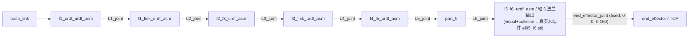

# a3_description_6j — EL-A3 6 轴 + 连杆描述包

**一句话职责：** 描述 **6 轴（L1–L6）+ 末端连杆** 形态的 EL-A3 机器人（F174）；与原 7 轴包
[`a3_description`](../a3_description) **整包隔离**（原包零改动，与主仓库一致）。

**本包是系统默认描述**：由 [`a3_robot_model`](../a3_robot_model) 的
`config/robot_model.yaml`（`description_package: a3_description_6j`）指定；真机栈与仿真栈
（`a3_bringup.launch.py`）默认即用它，`a3_stack.sh --7j` 可切回 7 轴形态。



## 关键文件

| 文件 | 说明 |
|------|------|
| `urdf/el_a3.urdf.xacro` | xacro 源：6 个可动关节 L1–L6（无 L7/夹爪）+ 固定连杆 `linkage_link` |
| `urdf/el_a3_ros2_control.xacro` | ros2_control：只声明 L1–L6（无 L7），参数路径指向本包 |
| `urdf/el_a3.urdf` | 由上面 xacro 生成的静态 URDF（Pinocchio / 限位读取用，改 xacro 后需重生成） |
| `config/` | 本形态专属配置（controllers 无夹爪、named_poses/gravity_scales/friction_params 均为 6 关节） |
| `meshes/` | 原包 mesh 副本（`package://a3_description_6j/meshes/...`） |
| `launch/` | 独立单包 launch（`el_a3_control` / `multi_arm_control` / `comm_test`，`FindPackageShare` 指本包） |

## 末端件（真实 STL）

末端几何由 CAD 导出的 [`meshes/el05_l6.stl`](meshes/el05_l6.stl) 承担（法兰盘 + φ46 段 + φ10 细杆，
贴轴 6 法兰面伸出 **150 mm**，细杆端面 = TCP）。该 mesh **单位是 mm 且坐标系与链接系不同**
（件自轴沿 mesh x，位于 mesh (y,z)≈(0.5,135.5)mm；贴合面 = mesh x=−42.15mm），
所以 URDF 里用 `scale` + `origin` 显式摆位，参数在 [el_a3.urdf.xacro](urdf/el_a3.urdf.xacro) 顶部：

| xacro arg | 默认 | 含义 |
|---|---|---|
| `linkage_mesh_scale` | `0.001 0.001 0.001` | mm → m |
| `linkage_mesh_origin` | `0.1355 -0.0005 0.04215` | 把 mesh 轴线/贴合面搬到 link z 轴 / 法兰面 |
| `linkage_mesh_rpy` | `0 -1.5708 0` | mesh +x → link +z（故 mesh −x = 向末端） |
| `linkage_tcp_z` | `-0.150` | TCP（`end_effector`）相对法兰面的 z 偏移 |

旧电机壳网格留档为 `meshes/el05_l6_bk.stl`（7 轴形态用，仅参考）。换件或重导出 CAD 后，
只需按新 mesh 的 bbox/自轴/贴合面重算上面 4 个值。

## 再生成静态 URDF（改 xacro 后必做）

```bash
source /opt/ros/humble/setup.bash && source install/setup.bash
xacro src/a3_description_6j/urdf/el_a3.urdf.xacro > src/a3_description_6j/urdf/el_a3.urdf
```

## 待办

1. **末端件质量待复核**：几何已用真实 STL；若实测质量与腕部组件标定值（`l5_l6_urdf_asm` 0.657 kg，
   含末端件）差异明显，再跑 `./scripts/a3_stack.sh calibrate model`。
2. **标定沿用现数据（无需重标）**：`config/inertia_params.yaml` / `gravity_scales.yaml` /
   `friction_params.yaml` / `kp_kd_gains.yaml` 即该形态（6 轴 + 连杆）标定值——F169/F170 那批
   标定就是在装好连杆的状态下做的。
3. **SRDF 碰撞对**：末端件现挂在 `l5_l6_urdf_asm` 本体上，`l5_l6_urdf_asm↔end_effector` 已登记、
   `part_9↔end_effector` Never（见 `a3_moveit_config/config/el_a3_6j.srdf`，F174/LL-165）。

> 需求：[docs/edge/requirements/F174-a3-description-6j-linkage-package.md](../../docs/edge/requirements/F174-a3-description-6j-linkage-package.md)
